# Perkembangan Doktrin Tritunggal dalam Sejarah Teologi Kristen

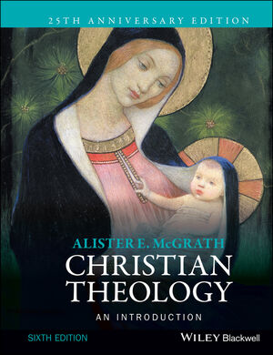
Berdasarkan Alister E. McGrath (2016), Christian Theology: An Introduction

## 1. Pendahuluan

Doktrin Tritunggal (The Doctrine of the Trinity) merupakan salah satu doktrin fundamental dalam iman Kristen. Doktrin ini menjelaskan bahwa Allah adalah satu dalam hakikat atau esensi-Nya, tetapi ada dalam tiga pribadi, yaitu Allah Bapa, Allah Anak (Yesus Kristus), dan Allah Roh Kudus.

Rumusan klasik doktrin Tritunggal adalah:

> Satu Allah dalam tiga pribadi: Bapa, Anak, dan Roh Kudus.

Doktrin Tritunggal tidak mengajarkan bahwa terdapat tiga Allah, melainkan satu Allah yang menyatakan diri dalam tiga pribadi yang berbeda dan setara dalam keilahian.

Penting dipahami bahwa istilah Tritunggal (Trinity) tidak secara eksplisit ditemukan dalam Alkitab. Namun, dasar ajarannya ditemukan dalam kesaksian Alkitab mengenai:
- Keberadaan dan keesaan Allah.
- Keilahian Yesus Kristus.
- Keilahian Roh Kudus.
- Relasi antara Bapa, Anak, dan Roh Kudus.

Beberapa ayat penting yang menjadi dasar pembahasan adalah:

| Ayat Alkitab        | Pokok ajaran                                  |
| ------------------- | --------------------------------------------- |
| Ulangan 6:4         | Keesaan Allah                                 |
| Matius 28:19        | Bapa, Anak, dan Roh Kudus                     |
| Yohanes 1:1–3       | Keilahian Firman                              |
| Yohanes 10:30       | Kesatuan Bapa dan Anak                        |
| Yohanes 14:16–17    | Relasi Bapa, Anak, dan Roh Kudus              |
| 2 Korintus 13:13–14 | Penyebutan ketiga pribadi secara bersama-sama |

Dengan demikian, doktrin Tritunggal berkembang melalui usaha gereja untuk menjelaskan kesaksian Alkitab secara teologis, terutama ketika menghadapi berbagai perdebatan mengenai keilahian Kristus dan Roh Kudus.

---
## 2. Latar Belakang Munculnya Doktrin Tritunggal

Pada masa gereja mula-mula, orang Kristen menghadapi pertanyaan mendasar:
1. Jika Allah itu satu, bagaimana Yesus Kristus dapat disebut Allah?
2. Apakah Yesus Kristus memiliki hakikat keilahian yang sama dengan Allah Bapa?
3. Apakah Roh Kudus juga memiliki keilahian?
4. Bagaimana hubungan antara Bapa, Anak, dan Roh Kudus dapat dijelaskan tanpa mengajarkan tiga Allah?

Pertanyaan-pertanyaan tersebut menjadi dasar perkembangan pemikiran Tritunggal.

Gereja mula-mula menerima tiga keyakinan utama:
- Allah adalah satu.
- Yesus Kristus adalah Allah.
- Roh Kudus adalah Allah.

Tantangan teologisnya adalah menjelaskan ketiga keyakinan tersebut secara konsisten tanpa menghilangkan keesaan Allah ataupun membedakan ketiga pribadi menjadi tiga Allah yang terpisah.

## 3. Tahapan Perkembangan Doktrin Tritunggal

### A. Periode Perjanjian Baru dan Gereja Mula-Mula (Abad I–II)

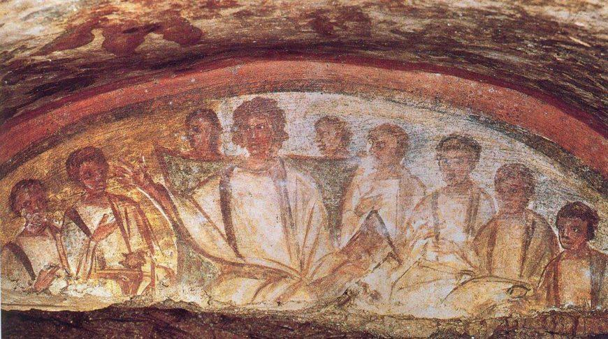

Pada periode ini, doktrin Tritunggal belum dirumuskan menggunakan terminologi teologis yang sistematis seperti yang dikenal sekarang.

Namun, dasar pemikiran Tritunggal sudah terlihat dalam tulisan-tulisan Perjanjian Baru.

1. Kesaksian mengenai Allah Bapa
	- Allah dipahami sebagai satu-satunya Allah, Pencipta, dan sumber segala sesuatu (1 Korintus 8:6).

2. Kesaksian mengenai Yesus Kristus
	- Yesus Kristus tidak hanya dipandang sebagai guru atau nabi, tetapi juga memiliki identitas ilahi.
	- Yohanes 1:1 menyatakan bahwa Firman itu bersama-sama dengan Allah dan Firman itu adalah Allah.

3. Kesaksian mengenai Roh Kudus
	- Roh Kudus dipahami sebagai pribadi ilahi yang bekerja dalam kehidupan orang percaya dan gereja. Dalam Kisah Para Rasul 5:3–4, berdusta kepada Roh Kudus dikaitkan dengan berdusta kepada Allah.

4. Penggunaan rumusan baptisan
	- Matius 28:19 menyebutkan baptisan dalam nama Bapa, Anak, dan Roh Kudus. Ayat ini menjadi salah satu dasar penting bagi perkembangan pemahaman Tritunggal.

Pada abad kedua, para penulis Kristen mulai menggunakan istilah dan penjelasan yang lebih terstruktur untuk memahami hubungan antara Bapa, Anak, dan Roh Kudus.

Tokoh penting pada periode ini antara lain:
- Ignatius dari Antiokhia: menegaskan identitas ilahi Yesus Kristus.
- Yustinus Martir: mengembangkan pemikiran mengenai hubungan Allah Bapa dan Logos (Firman).
- Irenaeus dari Lyon: menekankan karya Allah melalui Firman dan Roh Kudus dalam penciptaan serta keselamatan.

Inti perkembangan: Gereja mulai membangun pemahaman teologis tentang Bapa, Anak, dan Roh Kudus berdasarkan kesaksian Perjanjian Baru.

### B. Periode Apologetika dan Perumusan Terminologi Tritunggal (Abad II–III)
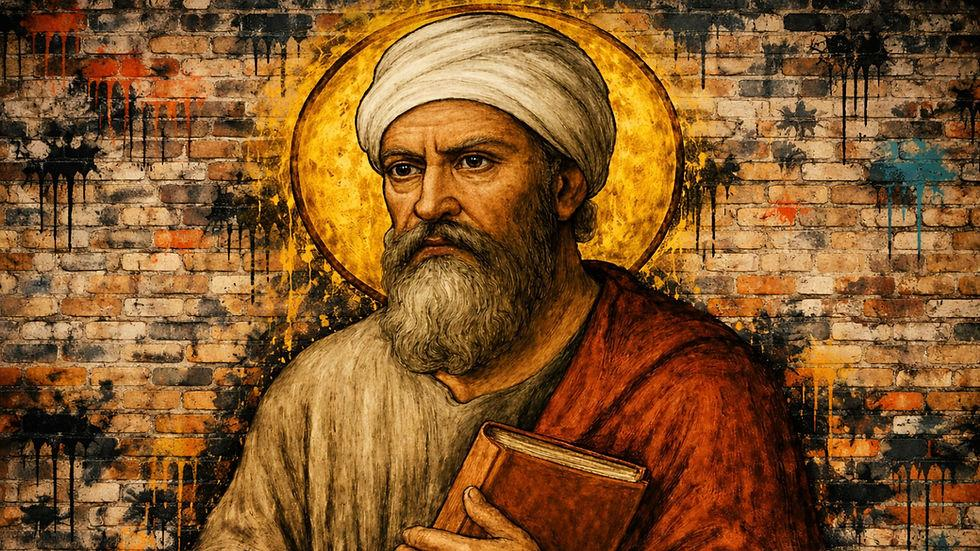

Pada periode ini, gereja mulai mengembangkan istilah teologis untuk menjelaskan Tritunggal, terutama dalam menghadapi ajaran yang dianggap tidak sesuai dengan iman Kristen.

Tokoh penting dalam perkembangan ini adalah Tertulianus (±155–220 M).

#### Tertulianus dan istilah Trinitas

Tertulianus merupakan salah satu teolog pertama yang menggunakan istilah Latin Trinitas untuk menjelaskan Allah Tritunggal.

Ia menggunakan istilah:
- *Una substantia*: satu substansi atau hakikat.
- *Tres personae*: tiga pribadi.

Rumusan ini menjadi salah satu fondasi penting bagi perkembangan terminologi Tritunggal dalam tradisi teologi Barat. Tertulianus berusaha menjelaskan bahwa Bapa, Anak, dan Roh Kudus berbeda sebagai pribadi, tetapi tidak berarti terdapat tiga Allah yang terpisah.

#### Kontroversi Modalisme

Pada masa ini, gereja juga menghadapi ajaran *Modalisme*.

Modalisme mengajarkan bahwa Bapa, Anak, dan Roh Kudus bukan tiga pribadi yang berbeda, melainkan tiga bentuk atau manifestasi dari satu Allah.

Sebagai contoh, dalam pandangan ini Allah dipahami tampil sebagai Bapa dalam penciptaan, Anak dalam penebusan, dan Roh Kudus dalam pengudusan.

Gereja menolak pemahaman tersebut karena menghilangkan perbedaan pribadi Bapa, Anak, dan Roh Kudus.

Inti perkembangan: Gereja mulai memiliki terminologi teologis untuk menjelaskan satu hakikat Allah dalam tiga pribadi.

### C. Konsili Nicea (325 M): Keilahian Yesus Kristus
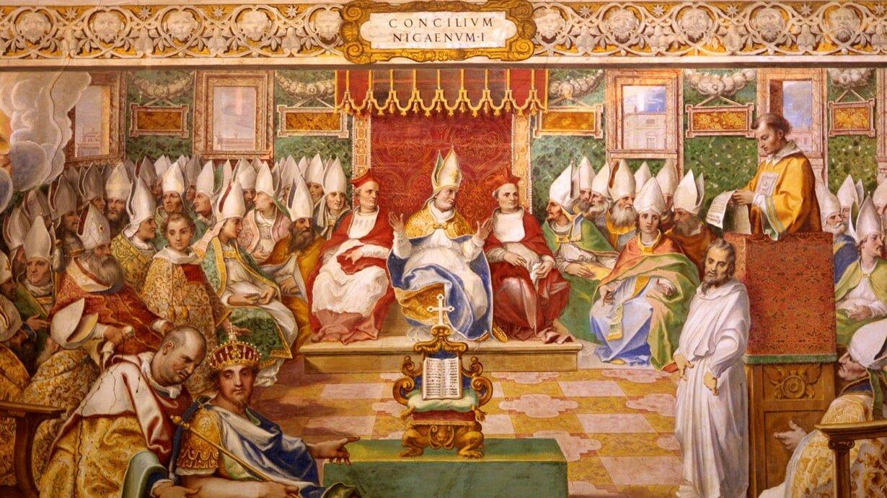

Salah satu peristiwa terpenting dalam sejarah doktrin Tritunggal adalah Konsili Nicea tahun 325 M.

Konsili ini diselenggarakan untuk menyelesaikan kontroversi Arianisme yang berkaitan dengan hubungan Allah Bapa dan Yesus Kristus.

#### Ajaran Arius

Arius mengajarkan bahwa Anak tidak kekal seperti Bapa. Anak merupakan ciptaan Allah dan memiliki kedudukan tertinggi di antara seluruh ciptaan.

Dengan demikian, menurut pandangan Arius, Anak tidak memiliki hakikat keilahian yang sama dengan Bapa.

Pandangan ini menimbulkan persoalan besar bagi gereja karena jika Kristus merupakan makhluk ciptaan, bagaimana Ia dapat menjadi Juruselamat yang membawa manusia kepada Allah?

#### Keputusan Konsili Nicea

Konsili Nicea menegaskan bahwa Yesus Kristus adalah:
- Allah sejati dari Allah sejati.
- Diperanakkan, bukan dijadikan.
- Sehakikat dengan Bapa (homoousios).

Istilah homoousios berarti memiliki hakikat atau substansi yang sama.

Artinya, Anak bukan makhluk ciptaan, melainkan sungguh-sungguh Allah dan memiliki keilahian yang sama dengan Bapa.

Athanasius dari Alexandria menjadi salah satu pembela utama keputusan Nicea.

Inti perkembangan: Konsili Nicea menegaskan kesetaraan keilahian Anak dengan Bapa dan menolak pandangan bahwa Kristus adalah makhluk ciptaan.

### D. Konsili Konstantinopel (381 M): Keilahian Roh Kudus

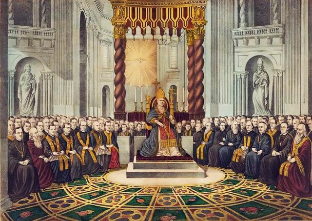
Setelah Konsili Nicea, perdebatan mengenai Tritunggal belum sepenuhnya selesai.

Perhatian gereja kemudian diarahkan pada status dan keilahian Roh Kudus.

Sebagian kelompok, yang sering dikaitkan dengan kaum Pneumatomakhian atau Makedonian, menolak atau merendahkan keilahian Roh Kudus.

Mereka menganggap Roh Kudus bukan Allah dalam pengertian yang sama dengan Bapa dan Anak.

#### Kontribusi para Bapa Kapadokia

Tiga tokoh penting yang memberikan kontribusi terhadap perkembangan doktrin Tritunggal adalah:
1. Basil dari Kaisarea (330–379 M): menegaskan keilahian Roh Kudus dan menjelaskan hubungan antara satu hakikat dan tiga pribadi.
2. Gregorius dari Nazianzus (329–390 M): menegaskan kesetaraan keilahian Bapa, Anak, dan Roh Kudus.
3. Gregorius dari Nyssa (335–395 M): mengembangkan penjelasan filosofis dan teologis mengenai kesatuan hakikat Allah dalam tiga pribadi.

Mereka membantu memperjelas terminologi:
- Ousia: hakikat atau esensi Allah.
- Hypostasis: pribadi atau keberadaan personal.

#### Keputusan Konsili Konstantinopel (381 M)

Konsili ini memperkuat pengakuan iman Nicea dan menegaskan keilahian Roh Kudus.

Roh Kudus diakui sebagai Tuhan dan pemberi kehidupan, yang bersama-sama dengan Bapa dan Anak disembah dan dimuliakan.

Dengan perkembangan ini, rumusan dasar doktrin Tritunggal semakin jelas: satu hakikat ilahi dalam tiga pribadi.

Inti perkembangan: Konsili Konstantinopel mempertegas bahwa Roh Kudus juga memiliki keilahian yang sama dengan Bapa dan Anak.

### E. Periode Agustinus (Abad IV–V): Pengembangan Pemahaman Teologis Tritunggal

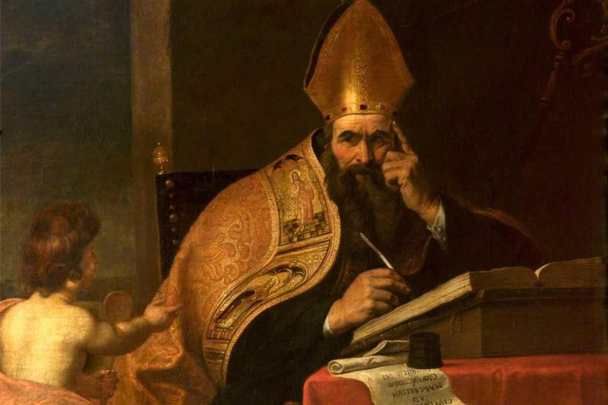

Setelah Konsili Nicea dan Konstantinopel, perkembangan doktrin Tritunggal semakin diarahkan pada pemahaman hubungan antara ketiga pribadi Allah.

Salah satu tokoh yang memberikan kontribusi besar adalah Agustinus dari Hippo (354–430 M).

Melalui karyanya De Trinitate (Tentang Tritunggal), Agustinus berusaha menjelaskan bagaimana Allah adalah satu dalam hakikat, tetapi tiga dalam pribadi.

Beberapa pokok pemikirannya:

1. Kesatuan hakikat Allah
	- Agustinus menekankan bahwa Bapa, Anak, dan Roh Kudus bukan tiga Allah yang berbeda. Ketiganya memiliki satu hakikat ilahi yang sama.

2. Relasi antara ketiga pribadi
	- Perbedaan antara Bapa, Anak, dan Roh Kudus tidak terletak pada tingkat keilahian, melainkan pada relasi pribadi masing-masing.
		- Bapa bukan Anak.
		- Anak bukan Roh Kudus.
		- Roh Kudus bukan Bapa.
	- Namun, ketiganya adalah satu Allah.

3. Analogi pikiran manusia
	- Agustinus menggunakan analogi kehidupan batin manusia untuk membantu menjelaskan Tritunggal.
	- Salah satu analoginya adalah:
		- Pikiran (mens).
		- Pengetahuan atau pengertian (notitia).
		- Kasih (amor).
	- Ketiganya dapat dibedakan, tetapi berada dalam satu kehidupan batin manusia.
	- Analogi ini bukan berarti manusia merupakan gambaran sempurna Allah Tritunggal. Agustinus menggunakannya sebagai alat bantu untuk memahami kesatuan dan relasi.

Inti perkembangan: Agustinus memperdalam penjelasan teologis mengenai kesatuan hakikat Allah dan relasi tiga pribadi dalam Tritunggal.

### F. Periode Abad Pertengahan (Abad VI–XV): Pengembangan Teologi Tritunggal secara Sistematis

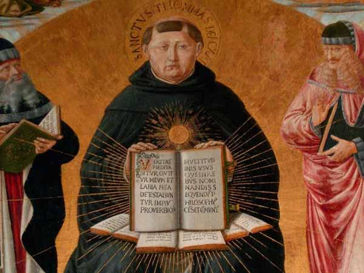

Pada Abad Pertengahan, doktrin Tritunggal terus dikembangkan melalui pendekatan filsafat dan teologi sistematis. Tokoh yang sangat berpengaruh adalah Thomas Aquinas (1225–1274). Dalam karya *Summa Theologiae*, Aquinas menjelaskan doktrin Tritunggal melalui pendekatan metafisika dan konsep relasi.

Beberapa penekanan pemikirannya:
1. Allah memiliki satu esensi atau hakikat ilahi.
2. Terdapat tiga pribadi yang berbeda dalam Allah.
3. Perbedaan pribadi didasarkan pada relasi asal-usul (relations of origin).
4. Anak berasal dari Bapa melalui proses diperanakkan secara kekal (eternal generation).
5. Roh Kudus berasal dari Bapa dan Anak menurut tradisi teologi Barat (filioque).

#### Perdebatan Filioque

Salah satu persoalan penting dalam sejarah doktrin Tritunggal adalah istilah *Filioque*, yang berarti "dan Anak".

Dalam pengakuan iman Barat, frasa ini ditambahkan untuk menjelaskan bahwa Roh Kudus berasal dari Bapa dan Anak.

Sementara itu, tradisi Gereja Timur mempertahankan rumusan bahwa Roh Kudus berasal dari Bapa, dengan merujuk pada rumusan pengakuan iman Konstantinopel.

Perbedaan ini menjadi salah satu persoalan teologis yang berkontribusi terhadap perpecahan antara Gereja Barat dan Gereja Timur pada tahun 1054.

Inti perkembangan: Doktrin Tritunggal semakin dikembangkan melalui penjelasan filosofis mengenai hakikat, pribadi, dan relasi asal-usul dalam Allah.

### G. Periode Reformasi (Abad XVI): Penegasan Kembali Doktrin Tritunggal

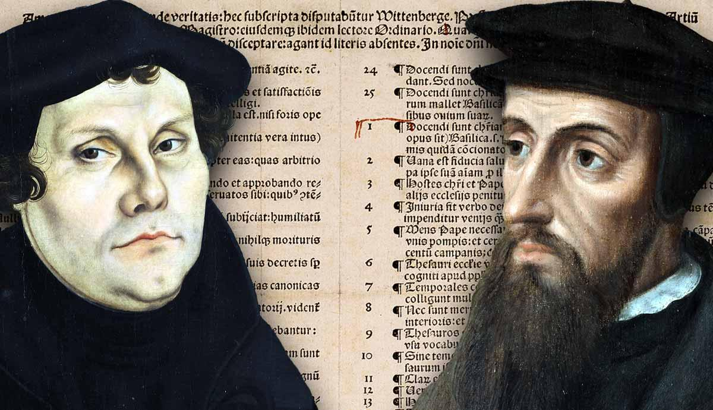

Pada masa Reformasi, para reformator tidak menolak doktrin Tritunggal yang telah dirumuskan oleh gereja mula-mula.

Sebaliknya, mereka mempertahankan pengakuan iman Tritunggal dan menempatkannya dalam kerangka otoritas Alkitab.

1. Martin Luther (1483–1546)
	- Luther mempertahankan keilahian Bapa, Anak, dan Roh Kudus. Ia menekankan bahwa keselamatan manusia merupakan karya Allah Tritunggal.

2. Yohanes Calvin (1509–1564)
	- Calvin memberikan pembahasan penting mengenai Tritunggal dalam Institutes of the Christian Religion.

Beberapa penekanannya adalah:
- Allah adalah satu dalam hakikat.
- Bapa, Anak, dan Roh Kudus merupakan tiga pribadi yang berbeda.
- Ketiganya memiliki keilahian yang setara dan kekal.
- Keilahian Yesus Kristus tidak lebih rendah daripada Bapa.
- Roh Kudus adalah Allah dan bekerja dalam kehidupan orang percaya.

Calvin juga menolak pandangan yang merendahkan keilahian Kristus maupun yang menghilangkan perbedaan pribadi dalam Tritunggal.

Inti perkembangan: Reformasi mempertahankan doktrin Tritunggal klasik dan menekankan kembali dasar Alkitab sebagai otoritas dalam memahami Allah.

### H. Periode Modern dan Kontemporer (Abad XVIII–XXI): Kritik dan Pembaruan Doktrin Tritunggal

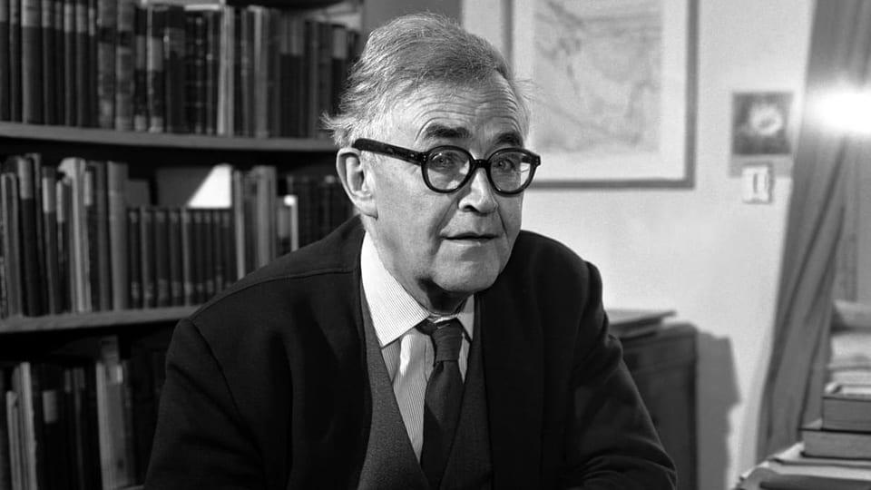

Pada periode modern, doktrin Tritunggal menghadapi tantangan baru akibat perkembangan rasionalisme, Pencerahan, filsafat modern, dan kritik terhadap agama.

#### 1. Pengaruh Rasionalisme dan Pencerahan

Pada masa Pencerahan, akal manusia mendapatkan perhatian yang sangat besar.

Sebagian pemikir menganggap doktrin Tritunggal sulit diterima secara rasional karena berbicara tentang satu Allah dalam tiga pribadi.

Akibatnya, beberapa pemikir teologi modern mulai mengurangi penekanan terhadap doktrin Tritunggal.

Deisme dan Unitarianisme merupakan contoh perkembangan pemikiran yang menolak atau tidak menerima pemahaman Tritunggal klasik.

#### 2. Friedrich Schleiermacher (1768–1834)

Schleiermacher menempatkan pengalaman religius manusia sebagai unsur penting dalam teologi. Dalam pemikirannya, doktrin Tritunggal tidak mendapatkan posisi yang sama seperti dalam teologi klasik. Ia membahasnya sebagai bagian dari refleksi sistematis mengenai iman Kristen.

#### 3. Karl Barth (1886–1968)

Karl Barth memberikan kontribusi penting dalam pembaruan pembahasan Tritunggal pada abad XX.

Dalam Church Dogmatics, Barth menempatkan doktrin Tritunggal sebagai dasar pemahaman tentang penyataan Allah.

Menurut Barth, Allah menyatakan diri-Nya sebagai:
- Allah yang menyatakan diri (Revealer).
- Allah yang dinyatakan (Revealed).
- Allah yang membuat penyataan-Nya dapat diterima (Revealing).

Ketiga cara tersebut berkaitan dengan Bapa, Anak, dan Roh Kudus.

Barth menegaskan bahwa Allah dikenal bukan karena manusia mampu menemukan-Nya melalui pemikiran sendiri, melainkan karena Allah berinisiatif menyatakan diri-Nya.

#### 4. Jürgen Moltmann (1926–2024)

Moltmann mengembangkan pendekatan sosial terhadap Tritunggal (Social Trinity). Ia memberikan perhatian pada relasi dan persekutuan antara Bapa, Anak, dan Roh Kudus.

Pemikirannya menekankan bahwa kehidupan Allah Tritunggal merupakan kehidupan persekutuan dan kasih.

Inti perkembangan: Teologi modern dan kontemporer kembali memberikan perhatian terhadap doktrin Tritunggal, khususnya dalam pembahasan penyataan Allah, relasi antarpribadi, kasih, dan kehidupan persekutuan.

---

## 4. Perbandingan Pemikiran Tokoh-Tokoh Penting dalam Perkembangan Doktrin Tritunggal

Untuk memahami perkembangan doktrin Tritunggal, berikut perbandingan kontribusi beberapa tokoh utama.

| Tokoh                | Periode     | Kontribusi utama                                             |
| -------------------- | ----------- | ------------------------------------------------------------ |
| Yustinus Martir      | Abad II     | Pemikiran mengenai Logos atau Firman Allah                   |
| Irenaeus             | Abad II     | Karya Allah melalui Firman dan Roh Kudus                     |
| Tertulianus          | Abad II–III | Penggunaan istilah Trinitas, satu substansi dan tiga pribadi |
| Athanasius           | Abad IV     | Mempertahankan keilahian Kristus                             |
| Basil dari Kaisarea  | Abad IV     | Penjelasan mengenai keilahian Roh Kudus                      |
| Gregorius Nazianzus  | Abad IV     | Kesetaraan ketiga pribadi dalam keilahian                    |
| Gregorius dari Nyssa | Abad IV     | Penjelasan satu hakikat dan tiga pribadi                     |
| Agustinus            | Abad IV–V   | Kesatuan hakikat dan relasi Tritunggal                       |
| Thomas Aquinas       | Abad XIII   | Penjelasan Tritunggal melalui metafisika dan relasi          |
| Yohanes Calvin       | Abad XVI    | Penegasan Tritunggal berdasarkan Alkitab                     |
| Karl Barth           | Abad XX     | Tritunggal sebagai dasar doktrin penyataan Allah             |
| Jürgen Moltmann      | Abad XX–XXI | Pendekatan sosial dan relasional terhadap Tritunggal         |

---

## 5. Konsep-Konsep Utama dalam Doktrin Tritunggal

Berdasarkan perkembangan sejarah tersebut, terdapat beberapa konsep teologis yang perlu dipahami mahasiswa.

### A. Satu Hakikat dan Tiga Pribadi
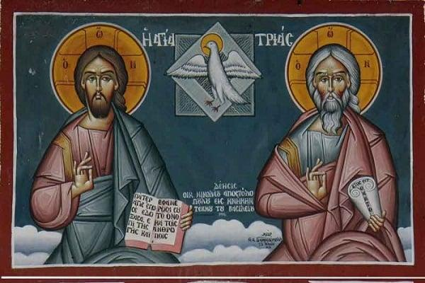

Doktrin Tritunggal menjelaskan bahwa Allah adalah satu dalam hakikat (ousia), tetapi tiga dalam pribadi (hypostasis).

Artinya:
- Bapa adalah Allah.
- Anak adalah Allah.
- Roh Kudus adalah Allah.
- Bapa bukan Anak.
- Anak bukan Roh Kudus.
- Roh Kudus bukan Bapa.
- Allah tetap satu, bukan tiga Allah.

Ketiga pribadi memiliki keilahian yang sama, kekal, dan tidak terbagi.

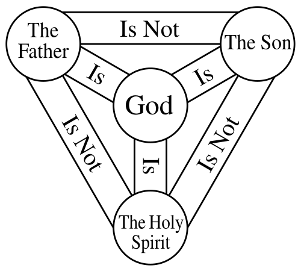

### B. Kesetaraan Ketiga Pribadi

Bapa, Anak, dan Roh Kudus memiliki hakikat ilahi yang sama. Tidak ada satu pribadi yang lebih tinggi atau lebih rendah dalam keilahian.

Hal ini penting untuk membedakan doktrin Tritunggal dari Arianisme yang menganggap Anak lebih rendah daripada Bapa.

### C. Perbedaan Pribadi dalam Tritunggal

Walaupun memiliki satu hakikat, ketiga pribadi memiliki perbedaan dalam relasi personalnya.

| Pribadi         | Karakteristik relasional                                   |
| --------------- | ---------------------------------------------------------- |
| Allah Bapa      | Tidak diperanakkan                                         |
| Allah Anak      | Diperanakkan secara kekal dari Bapa                        |
| Allah Roh Kudus | Berasal dari Bapa; dalam tradisi Barat, dari Bapa dan Anak |

Perbedaan ini tidak menunjukkan perbedaan tingkat keilahian.

### D. Karya Allah Tritunggal

Dalam teologi Kristen, karya Allah dalam penciptaan, penebusan, dan pengudusan dapat dibahas dengan memperhatikan peran khas setiap pribadi.

|Pribadi|Penekanan karya|
|---|---|
|Bapa|Penciptaan dan pemeliharaan|
|Anak|Inkarnasi dan penebusan|
|Roh Kudus|Pengudusan dan pembaruan kehidupan|

Namun, perlu dipahami bahwa karya Allah terhadap ciptaan merupakan karya satu Allah Tritunggal, bukan tiga pekerjaan yang terpisah secara mutlak.

---
## 6. Ajaran yang Ditolak dalam Doktrin Tritunggal

Dalam sejarahnya, gereja juga merumuskan doktrin Tritunggal dengan membedakannya dari beberapa pandangan yang dianggap menyimpang.

| Pandangan         | Penjelasan                                               | Mengapa ditolak dalam teologi Tritunggal klasik |
| ----------------- | -------------------------------------------------------- | ----------------------------------------------- |
| Arianisme         | Anak adalah ciptaan dan bukan Allah sejati               | Menyangkal kesetaraan keilahian Anak            |
| Modalisme         | Bapa, Anak, dan Roh Kudus hanya tiga manifestasi Allah   | Menghilangkan perbedaan pribadi                 |
| Tritheisme        | Bapa, Anak, dan Roh Kudus merupakan tiga Allah           | Menyangkal keesaan Allah                        |
| Subordinasianisme | Anak atau Roh Kudus lebih rendah dalam hakikat keilahian | Tidak mempertahankan kesetaraan hakikat ilahi   |

## 7. Kesimpulan: Makna Historis Perkembangan Doktrin Tritunggal

Perkembangan doktrin Tritunggal memperlihatkan bagaimana gereja sepanjang sejarah berusaha memahami dan menjelaskan identitas Allah berdasarkan kesaksian Alkitab.

Perkembangan tersebut dapat disimpulkan dalam lima tahap penting:
1. Gereja mula-mula: Menerima kesaksian Alkitab mengenai Bapa, Anak, dan Roh Kudus, serta mulai mengembangkan pemahaman tentang hubungan ketiganya.
2. Abad II–III: Mengembangkan terminologi teologis melalui pemikiran Tertulianus mengenai satu substansi dan tiga pribadi.
3. Abad IV: Merumuskan pengakuan iman Tritunggal melalui Konsili Nicea (325) dan Konstantinopel (381), terutama mengenai kesetaraan keilahian Bapa, Anak, dan Roh Kudus.
4. Abad Pertengahan dan Reformasi: Memperdalam pemahaman mengenai hakikat, pribadi, dan relasi dalam Tritunggal serta mempertahankan doktrin tersebut berdasarkan iman Kristen.
5. Zaman Modern dan Kontemporer: Mengembangkan kembali pembahasan Tritunggal dalam konteks penyataan Allah, relasi, kasih, dan kehidupan manusia.

Pokok teologis yang harus dipahami: Doktrin Tritunggal bukanlah ajaran mengenai tiga Allah ataupun satu Allah yang sekadar menggunakan tiga bentuk penampilan. Doktrin ini mengajarkan satu Allah dalam tiga pribadi yang berbeda, setara, dan kekal.

---
## 🎓 Diskusi & Tugas

1. Mengapa gereja mula-mula merasa perlu merumuskan doktrin Tritunggal secara sistematis?
2. Apa perbedaan utama antara ajaran Arianisme dan doktrin Tritunggal Nicea?
3. Mengapa Konsili Nicea (325 M) dan Konstantinopel (381 M) sangat penting dalam sejarah doktrin Tritunggal?
4. Apa kontribusi Tertulianus, Agustinus, dan Thomas Aquinas terhadap perkembangan doktrin Tritunggal?
5. Bagaimana doktrin Tritunggal menjelaskan hubungan antara satu hakikat Allah dan tiga pribadi?
6. Mengapa doktrin Tritunggal tetap relevan bagi kehidupan iman Kristen masa kini?

---
---