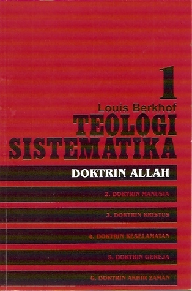
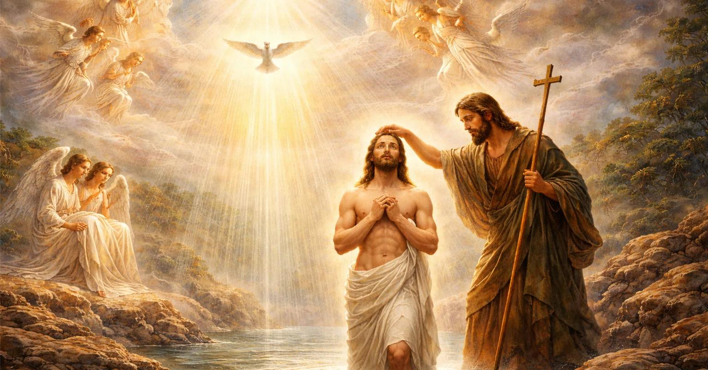
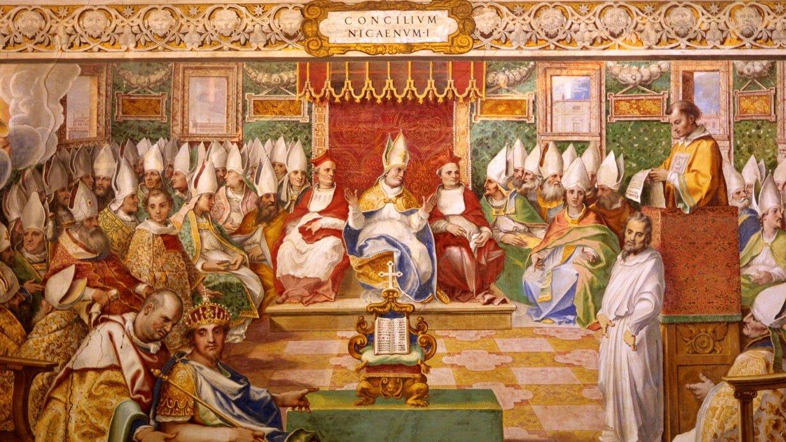
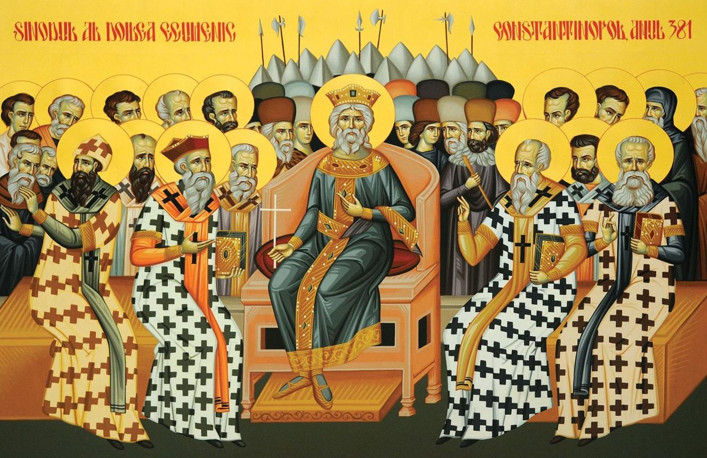

# Doktrin Allah

## 1. Pendahuluan

Doktrin Allah (The Doctrine of God) merupakan salah satu pokok utama dalam teologi sistematika. Doktrin ini membahas keberadaan Allah, hakikat Allah, sifat-sifat Allah, nama-nama Allah, karya Allah, serta hubungan Allah dengan ciptaan-Nya.

Dalam perspektif teologi Reformed, pembahasan mengenai doktrin Allah tidak dimulai dari spekulasi manusia tentang siapa Allah, melainkan dari penyataan Allah sendiri melalui Alkitab.

Salah satu teolog Reformed yang memberikan pembahasan sistematis mengenai doktrin ini adalah Louis Berkhof dalam bukunya Systematic Theology.

Menurut pendekatan Berkhof, Allah adalah pusat dari seluruh realitas dan teologi Kristen. Seluruh pembahasan mengenai penciptaan, manusia, dosa, keselamatan, gereja, dan akhir zaman harus dipahami berdasarkan keberadaan serta karya Allah.

Tujuan mempelajari doktrin Allah:
1. Memahami siapa Allah berdasarkan penyataan Alkitab.
2. Mengenal hakikat dan karakter Allah.
3. Memahami sifat-sifat Allah dan kesempurnaan-Nya.
4. Memahami relasi Allah Tritunggal.
5. Memahami karya Allah dalam penciptaan, pemeliharaan, dan pemerintahan dunia.
6. Membangun kehidupan iman, penyembahan, dan ketaatan berdasarkan pengenalan yang benar tentang Allah.

> 🧑‍🏫 Sebagian besar pembahasan Doktrin Allah adalah pemikiran dari Louis Berkhof yang diambil dari buku Teologi Sistematika jilid 1. Karya Berkhof ini cukup banyak digunakan dan menjadi rujukan standar, terutama di kalangan teolog, pendeta, dan mahasiswa seminari berlatar belakang Protestan secara umum.

---
## 2. Konsep Dasar Doktrin Allah

Pembahasan tentang Allah menekankan bahwa Allah adalah Pribadi yang hidup, berdaulat, tidak terbatas, dan menyatakan diri-Nya kepada manusia.

Ada beberapa prinsip mendasar yang perlu dipahami.

### A. Allah dapat dikenal, tetapi tidak dapat dipahami secara sempurna oleh manusia

Allah dapat dikenal karena Ia telah menyatakan diri-Nya kepada manusia. Penyataan tersebut terutama diberikan melalui:
- **Penyataan umum (*General Revelation*)**: Allah menyatakan keberadaan dan kemuliaan-Nya melalui alam semesta, ciptaan, dan hati nurani manusia.
	- 🧑‍🏫 Semua orang bisa melihatnya, orang percaya maupun tidak percaya.
- **Penyataan khusus (*Special Revelation*)**: Allah menyatakan diri-Nya secara khusus melalui firman-Nya dan puncaknya dalam pribadi Yesus Kristus.

> 🍎 Si comprehendis, non est Deus - St. Augustine

Manusia tidak mungkin memahami Allah secara sempurna karena keberadaan Allah tidak terbatas, sedangkan kemampuan manusia terbatas. Dengan demikian, terdapat perbedaan antara mengenal Allah (knowledge of God) dan memahami Allah secara menyeluruh (comprehension of God).

Dasar Alkitab:
- [Roma 1:19–20](https://alkitab.sabda.org/passage.php?passage=Roma%201:19-20)
- [Mazmur 19:1–7](https://alkitab.sabda.org/passage.php?passage=Mazmur%2019:1–7)
- [Yohanes 1:18](https://alkitab.sabda.org/passage.php?passage=Yohanes%201:18)
- [Ayub 11:7–9](https://alkitab.sabda.org/passage.php?passage=Ayub%2011:7-9)
- [1 Korintus 13:12](https://alkitab.sabda.org/passage.php?passage=1%20Korintus%2013:12)

### B. Pengetahuan tentang Allah bersumber dari penyataan Allah

- Manusia tidak dapat mengenal Allah secara benar hanya melalui rasio, pengalaman, atau pengamatan alam.
- Rasio manusia dapat digunakan untuk memahami penyataan Allah, tetapi bukan menjadi sumber tertinggi untuk menentukan siapa Allah.
- Alkitab menjadi otoritas utama dalam membangun doktrin tentang Allah.
- Implikasi teologis: Teologi bukanlah usaha manusia menciptakan konsep tentang Allah, melainkan usaha memahami dan menyusun secara sistematis kebenaran yang telah Allah nyatakan.

## 3. Keberadaan Allah (The Existence of God)

Keberadaan Allah merupakan dasar dari seluruh pembahasan teologi. Alkitab tidak memulai dengan membuktikan keberadaan Allah secara filosofis, tetapi langsung menyatakan bahwa Allah ada.

Kejadian 1:1 menyatakan:

> "Pada mulanya Allah menciptakan langit dan bumi."

Pernyataan ini menunjukkan bahwa Allah merupakan Pribadi yang sudah ada sebelum segala sesuatu diciptakan. Allah bukan bagian dari alam semesta, melainkan Pencipta alam semesta.

> 🧑‍🏫 Tujuan kisah penciptaan dalam Kejadian bukanlah menceritakan "bagaimana proses mekanisme penciptaan", tapi "Ada Allah yang menciptakan alam semesta ini"

### A. Kesaksian Alkitab tentang keberadaan Allah

Beberapa dasar Alkitab:
- Kejadian 1:1 – Allah sebagai Pencipta.
- Keluaran 3:14 – Allah menyatakan diri sebagai "AKU ADALAH AKU".
- Mazmur 14:1 – Penolakan terhadap Allah merupakan kebodohan manusia.
- Yohanes 1:1–3 – Firman telah ada sejak semula dan segala sesuatu dijadikan melalui Dia.
- Kisah Para Rasul 17:24–28 – Allah adalah Pencipta dan sumber kehidupan manusia.

### B. Bukti rasional tentang keberadaan Allah

Berkhof juga membahas sejumlah argumentasi rasional yang secara historis digunakan untuk mendukung keberadaan Allah. Argumentasi tersebut bukan dasar iman yang berdiri sendiri, tetapi dapat membantu manusia memahami rasionalitas kepercayaan kepada Allah.

Empat argumentasi yang umum dibahas dalam teologi:

| Argumentasi | Penjelasan                                                                                                   |
| ----------- | ------------------------------------------------------------------------------------------------------------ |
| Kosmologis  | Alam semesta memiliki sebab atau dasar keberadaan yang tidak dapat dijelaskan hanya melalui dirinya sendiri. |
| Teleologis  | Keteraturan dan tujuan dalam alam semesta menunjuk kepada Sang Perancang.                                    |
| Ontologis   | Berangkat dari konsep tentang keberadaan Allah sebagai Pribadi yang paling sempurna.                         |
| Moral       | Kesadaran manusia tentang kewajiban moral menunjuk kepada dasar moral yang tertinggi.                        |

Argumentasi rasional dapat memberikan dukungan, tetapi tidak menghasilkan pengetahuan keselamatan atau pengenalan pribadi terhadap Allah tanpa penyataan-Nya.

> 🧑‍🏫 Perdebatan teologis secara intelektual tidak menghasilkan pertobatan. Hanya jika ia menerima kebenaran Allah (melalui pekerjaan Roh Kudus), maka seseorang bisa mengalami pertobatan

---
## 4. Pengenalan terhadap Allah (The Knowability of God)

Salah satu prinsip penting adalah bahwa Allah tidak dapat dipahami secara sempurna, tetapi dapat dikenal secara nyata.

Prinsip ini disebut:

> God is incomprehensible but knowable.

Artinya, manusia dapat mengetahui kebenaran tentang Allah, tetapi tidak dapat menguasai seluruh keberadaan Allah melalui pemikirannya.

### A. Allah tidak terbatas, manusia terbatas

Allah memiliki keberadaan yang tidak terbatas, sedangkan manusia adalah ciptaan yang terbatas.

Sebagai contoh:

- Manusia dapat mengetahui bahwa Allah itu kekal, tetapi tidak dapat mengalami kekekalan seperti Allah.
- Manusia dapat mengetahui bahwa Allah mahahadir, tetapi tidak dapat memahami sepenuhnya bagaimana kehadiran Allah mencakup seluruh ruang.
- Manusia dapat mengetahui bahwa Allah mahatahu, tetapi tidak memiliki pengetahuan seperti Allah.

> 🧑‍🏫 Dalam setiap perenungan tentang Allah, kita perlu menyadari keterbatasan kita. Tidak perlu berambisi untuk mengerti dan memahami segalanya, karena itu memang tidak mungkin. Hal ini seharusnya tidak menjadi sesuatu yang menjadi kebingungan atau sumber kebimbangan, tapi *ketidakterbatasan Allah* menjadi sumber kekaguman kita. 

### B. Allah menyatakan diri-Nya

Allah dapat dikenal karena Ia sendiri mengambil inisiatif untuk menyatakan diri-Nya.

Ada dua bentuk penyataan:

1. **Penyataan umum (*General Revelation*)**: Allah menyatakan keberadaan, kuasa, dan kemuliaan-Nya melalui:
	- Alam semesta ([Mazmur 19:1](https://alkitab.sabda.org/passage.php?passage=Mazmur%2019:1)).
	- Ciptaan ([Roma 1:20](https://alkitab.sabda.org/passage.php?passage=Roma%201:20)).
	- Hati nurani manusia ([Roma 2:14–15](https://alkitab.sabda.org/passage.php?passage=Roma%2:14-15)).
	- Pemeliharaan kehidupan ([Kisah Para Rasul 14:17](https://alkitab.sabda.org/passage.php?passage=Kis%2014:17)).

2. **Penyataan khusus (*Special Revelation*)**: Allah menyatakan diri-Nya secara khusus melalui:
	- Firman Allah.
	- Sejarah tindakan penyelamatan Allah.
	- Pribadi dan karya Yesus Kristus
		- Yohanes 1:18 menyatakan bahwa Anak Tunggal Allah menyatakan Bapa.

> Pengetahuan manusia tentang Allah merupakan hasil anugerah penyataan Allah, bukan semata-mata pencapaian intelektual manusia.

---
## 5. Nama-Nama Allah (The Names of God)

Nama Allah bukan sekadar sebutan atau identitas linguistik. Nama Allah menyatakan karakter, keberadaan, dan hubungan Allah dengan ciptaan-Nya.

Nama-nama Allah dalam Alkitab memberikan gambaran tentang bagaimana Allah memperkenalkan diri-Nya.

### A. Nama-nama Allah dalam Perjanjian Lama

1. **YHWH (Yahweh)** (Hebrew: יהוה)
	- Menunjukkan nama perjanjian Allah. Berkaitan dengan keberadaan Allah yang kekal dan kesetiaan-Nya terhadap umat-Nya.
	- Referensi: Keluaran 3:14–15.

2. **Elohim** (Ibrani: אֱלֹהִים)
	- Nama yang digunakan untuk Allah sebagai Pencipta yang berkuasa dan berdaulat.
	- Referensi: Kejadian 1:1.

3. **El Shaddai** (Ibrani: אֵל שַׁדַּי )
	- Secara tradisional diterjemahkan sebagai Allah Yang Mahakuasa. Menekankan kuasa dan kecukupan Allah.
	- Referensi: Kejadian 17:1.

4. **Adonai** (Ibrani: **אֲדֹנָי** )
	- Berarti Tuhan atau Penguasa. Menekankan otoritas dan kedaulatan Allah atas umat-Nya.
	- Referensi: Mazmur 8:2.

### B. Nama-nama Allah dalam Perjanjian Baru

| Nama        | Makna               | Referensi   |
| ----------- | ------------------- | ----------- |
| Theos       | Allah               | Yohanes 1:1 |
| Kurios      | Tuhan atau Penguasa | Filipi 2:11 |
| Pater       | Bapa                | Matius 6:9  |
| Pantokrator | Yang Mahakuasa      | Wahyu 1:8   |

Penting dipahami bahwa nama-nama tersebut tidak menggambarkan Allah secara menyeluruh, tetapi menyatakan aspek-aspek keberadaan dan hubungan-Nya dengan manusia.

---
## 6. Sifat-Sifat Allah (The Attributes of God)

Sifat-sifat Allah dibagi ke dalam dua kategori besar:
1. Sifat-sifat Allah yang tidak dapat dikomunikasikan (Incommunicable Attributes).
2. Sifat-sifat Allah yang dapat dikomunikasikan (Communicable Attributes).

Pembagian ini tidak berarti bahwa ada sifat Allah yang dapat dimiliki manusia dengan tingkat atau hakikat yang sama. Istilah communicable berarti sifat-sifat tertentu dapat tercermin secara terbatas dalam kehidupan manusia sebagai gambar Allah.

### A. Sifat Allah yang tidak dapat dikomunikasikan

Sifat-sifat ini menekankan perbedaan mendasar antara Allah dan ciptaan-Nya.

1. **Self-Existence (Keberadaan pada Diri-Nya Sendiri)**
	- Allah tidak bergantung pada sesuatu di luar diri-Nya untuk hidup dan berada. Ia adalah sumber keberadaan segala sesuatu.
	- Referensi: Keluaran 3:14; Yohanes 5:26.

2. **Eternity (Kekekalan)**
	- Allah tidak memiliki awal dan akhir. Ia melampaui keterbatasan waktu.
	- Referensi: Mazmur 90:2; Wahyu 1:8.

> 👨‍🏫 Dalam teologi Kristen, **kekekalan Allah** bukan sekadar “waktu yang sangat panjang” atau hidup tanpa akhir. Kekekalan berarti Allah tidak dibatasi oleh waktu.
> St. Agustinus secara khusus mengatakan bahwa kekekalan bukan waktu yang sangat panjang: dalam kekekalan Allah, seluruh kenyataan hadir tanpa ada yang berlalu.

3. **Immutability (Ketidakberubahan)**
	- Hakikat, kesempurnaan, tujuan, dan janji Allah tidak berubah.
	- Referensi: Maleakhi 3:6; Yakobus 1:17.

4. **Infinity (Ketidakterbatasan)**
	- Allah tidak dibatasi oleh ruang, waktu, maupun keterbatasan ciptaan.
	- Referensi: 1 Raja-raja 8:27.

5. **Unity (Kesatuan)**
	- Hanya ada satu Allah. Hakikat ilahi Allah tidak terbagi.
	- Referensi: Ulangan 6:4; 1 Korintus 8:4–6.

Penjelasan teologis:

Sifat-sifat ini menegaskan bahwa Allah berbeda secara ontologis dari seluruh ciptaan. Allah bukan makhluk yang lebih besar atau lebih kuat daripada manusia, tetapi Pencipta yang keberadaan-Nya tidak bergantung pada ciptaan.

### B. Sifat Allah yang dapat dikomunikasikan

Sifat-sifat ini menunjukkan kesempurnaan Allah yang dapat tercermin secara terbatas dalam kehidupan manusia. Sifat-sifat ini dikelompokan dalam dimensi spiritual, intelektual, moral, dan kedaulatan.

| Kelompok    | Sifat Allah    | Penjelasan                                                             |
| ----------- | -------------- | ---------------------------------------------------------------------- |
| Spiritual   | Spirituality   | Allah adalah Roh, bukan makhluk jasmani.                               |
| Intelektual | Knowledge      | Allah mengetahui segala sesuatu.                                       |
| Intelektual | Wisdom         | Allah bertindak dengan hikmat sempurna.                                |
| Intelektual | Truthfulness   | Allah adalah kebenaran dan tidak berdusta.                             |
| Moral       | Goodness       | Allah adalah sumber segala kebaikan.                                   |
| Moral       | Love           | Allah adalah kasih.                                                    |
| Moral       | Grace          | Allah memberikan anugerah kepada manusia yang tidak layak menerimanya. |
| Moral       | Mercy          | Allah menunjukkan belas kasihan.                                       |
| Moral       | Long-suffering | Allah panjang sabar terhadap manusia.                                  |
| Moral       | Holiness       | Allah sepenuhnya kudus dan terpisah dari dosa.                         |
| Moral       | Righteousness  | Allah selalu benar dan adil.                                           |
| Kedaulatan  | Sovereignty    | Allah berkuasa dan memerintah atas segala sesuatu.                     |

Beberapa sifat penting untuk dipahami lebih lanjut:

1. **Omnipotence (Mahakuasa)**
	- Allah memiliki kuasa untuk melakukan segala sesuatu yang sesuai dengan hakikat dan kehendak-Nya. Allah tidak dapat melakukan sesuatu yang bertentangan dengan kesempurnaan-Nya, seperti berdusta atau menyangkal diri-Nya sendiri.
	- Referensi: [Kejadian 18:14](https://alkitab.sabda.org/passage.php?passage=Kejadian18:14); [Lukas 1:37](https://alkitab.sabda.org/passage.php?passage=Lukas%201:37).

2. **Omniscience (Mahatahu)**
	- Allah mengetahui segala sesuatu, termasuk masa lalu, masa kini, dan masa depan. Tidak ada sesuatu pun yang tersembunyi dari pengetahuan-Nya.
	- Referensi: [Mazmur 139:1–6](https://alkitab.sabda.org/passage.php?passage=Mazmur%20139:1-6); [Ibrani 4:13](https://alkitab.sabda.org/passage.php?passage=Ibrani%204:13).

3. **Omnipresence (Mahahadir)**
	- Allah hadir di segala tempat. Kehadiran-Nya tidak dibatasi oleh ruang.
	- Referensi: [Mazmur 139:7–10](https://alkitab.sabda.org/passage.php?passage=Mazmur%1139:7-10); [Yeremia 23:23–24](https://alkitab.sabda.org/passage.php?passage=Yeremia%2023:23-24).

4. **Holiness (Kekudusan)**
	- Allah sepenuhnya suci, murni, dan tidak memiliki dosa. Kekudusan merupakan karakter fundamental Allah.
	- Referensi: [Yesaya 6:3](https://alkitab.sabda.org/passage.php?passage=Yesaya%206:3); [1 Petrus 1:15–16](https://alkitab.sabda.org/passage.php?passage=1%20Petrus%201:15-16).

5. **Love (Kasih)**
	- Kasih merupakan bagian dari hakikat Allah. Kasih Allah dinyatakan secara nyata melalui karya keselamatan dalam Yesus Kristus.
	- Referensi: [1 Yohanes 4:8–10](https://alkitab.sabda.org/passage.php?passage=1%20Yohanes%204:8-10).

6. **Justice (Keadilan)**
	- Allah selalu bertindak benar dan tidak melakukan ketidakadilan. Ia menghakimi manusia berdasarkan kebenaran.
	- Referensi: Ulangan 32:4; Roma 2:6.

---
## 7. Doktrin Allah Tritunggal (The Holy Trinity)

Doktrin Tritunggal merupakan salah satu ajaran paling mendasar dalam teologi Kristen. Doktrin Tritunggal mengajarkan bahwa:

> Allah adalah satu dalam hakikat atau esensi ilahi, tetapi tiga dalam Pribadi, yaitu Bapa, Anak, dan Roh Kudus.

Dengan demikian, Kekristenan tidak mengajarkan tiga Allah (Tritheisme), dan juga tidak mengajarkan bahwa satu Pribadi Allah hanya berganti-ganti peran atau penampilan (Modalisme).

### A. Dasar Alkitab tentang Tritunggal

1. **Allah adalah satu**
	- Ulangan 6:4 – Tuhan itu esa.
	- Yesaya 45:5 – Tidak ada Allah selain Tuhan.
	- 1 Korintus 8:4–6 – Hanya ada satu Allah.

2. **Bapa adalah Allah**
	- Yohanes 6:27
	- 1 Korintus 8:6
	- Efesus 4:6

3. **Anak adalah Allah**
	- Yohanes 1:1 – Firman adalah Allah.
	- Yohanes 20:28 – Tomas mengakui Yesus sebagai Tuhan dan Allah.
	- Kolose 2:9 – Seluruh kepenuhan ke-Allahan berdiam secara jasmaniah dalam Kristus.

4. **Roh Kudus adalah Allah**
	- Kisah Para Rasul 5:3–4 – Berdusta kepada Roh Kudus berarti berdusta kepada Allah.
	- 1 Korintus 3:16–17 – Orang percaya adalah bait Allah karena Roh Allah diam di dalam mereka.
	- 2 Korintus 3:17 – Tuhan adalah Roh.

5. **Ketiga Pribadi dibedakan**
	- Matius 3:16–17 memperlihatkan ketiga Pribadi dalam peristiwa pembaptisan Yesus:
		- Anak dibaptis.
		- Roh Kudus turun seperti burung merpati.
		- Bapa menyatakan perkenanan-Nya dari surga.

### B. Satu esensi dan tiga Pribadi

| Pribadi         | Identitas teologis               |
| --------------- | -------------------------------- |
| Allah Bapa      | Pribadi pertama dalam Tritunggal |
| Allah Anak      | Pribadi kedua dalam Tritunggal   |
| Allah Roh Kudus | Pribadi ketiga dalam Tritunggal  |

Ketiganya memiliki:
- Hakikat ilahi yang sama.
- Kekekalan yang sama.
- Kemuliaan yang sama.
- Kuasa dan kesempurnaan ilahi yang sama.

Namun, ketiganya bukan Pribadi yang sama.

### C. Perbedaan personal dalam Tritunggal

Dalam teologi Reformed, terdapat perbedaan relasi asal-usul (relations of origin):
1. Bapa diperanakkan bukan oleh siapa pun.
2. Anak diperanakkan secara kekal oleh Bapa (eternal generation).
3. Roh Kudus keluar secara kekal dari Bapa dan Anak (eternal procession).

Istilah diperanakkan secara kekal tidak berarti Anak diciptakan atau memiliki permulaan waktu. Anak adalah Allah yang kekal.

Demikian pula, Roh Kudus bukan ciptaan atau kuasa impersonal, melainkan Pribadi ilahi.
#### Ketiga Pribadi dibedakan dalam satu kesaksian Alkitab

Salah satu ayat yang sangat penting adalah Matius 28:19.

> "Baptislah mereka dalam nama Bapa dan Anak dan Roh Kudus."

Perhatikan bahwa kata "nama" menggunakan bentuk tunggal, sedangkan terdapat tiga Pribadi yang disebutkan.

Ayat ini menunjukkan kesatuan ilahi sekaligus pembedaan personal antara Bapa, Anak, dan Roh Kudus.

Ayat penting lainnya adalah Matius 3:16–17, yaitu peristiwa pembaptisan Yesus.

### D. Tritunggal dalam karya keselamatan

Ketiga Pribadi memiliki karya yang berbeda secara personal, tetapi tidak terpisah dalam tindakan ilahi.

| Pribadi   | Karya dalam keselamatan                                      | Referensi      |
| --------- | ------------------------------------------------------------ | -------------- |
| Bapa      | Memilih dan menetapkan rencana keselamatan                   | Efesus 1:3–6   |
| Anak      | Menebus manusia melalui kematian dan kebangkitan-Nya         | Efesus 1:7–12  |
| Roh Kudus | Memeteraikan dan menerapkan keselamatan kepada orang percaya | Efesus 1:13–14 |

> 🔴 Pembagian karya tersebut tidak berarti bahwa ketiga Pribadi bekerja secara terpisah. Dalam teologi klasik, karya *Allah ke luar* (*opera ad extra*) merupakan karya Allah Tritunggal yang satu, meskipun tindakan tertentu dapat secara khusus dikaitkan dengan salah satu Pribadi.

### Perkembangan Historis Doktrin Tritunggal

Untuk memahami doktrin Tritunggal, adalah penting untuk mengetahui bagaimana gereja mula-mula merumuskan ajaran ini.

Doktrin Tritunggal tidak dirumuskan dalam satu waktu. Gereja mula-mula menghadapi berbagai pertanyaan teologis mengenai hubungan antara Bapa, Anak, dan Roh Kudus.

Pertanyaan-pertanyaan tersebut antara lain:
- Jika Allah hanya satu, bagaimana Yesus dapat disebut Allah?
- Jika Yesus adalah Allah, apakah Ia sama dengan Bapa?
- Jika Roh Kudus adalah Allah, mengapa Ia dibedakan dari Bapa dan Anak?
- Apakah Anak memiliki keberadaan yang sama kekalnya dengan Bapa?
- Apakah Roh Kudus memiliki hakikat ilahi yang sama dengan Bapa dan Anak?

Perdebatan tersebut mendorong gereja untuk merumuskan doktrin Tritunggal secara lebih jelas.

#### Periode Gereja Mula-Mula

Pada periode gereja mula-mula, para rasul dan jemaat Kristen telah menyembah Allah Bapa, mengakui Yesus Kristus sebagai Tuhan, serta mengalami pekerjaan Roh Kudus.

Namun, mereka menghadapi tantangan untuk menjelaskan hubungan ketiga Pribadi tersebut secara teologis.

Beberapa tokoh Kristen mula-mula memberikan kontribusi penting dalam pembentukan rumusan doktrin Tritunggal.

##### A. Tertullianus (sekitar 155–220 M)

Tertullianus merupakan salah satu tokoh yang memberikan kontribusi penting dalam penggunaan istilah Tritunggal.

Ia menggunakan istilah Latin Trinitas untuk menjelaskan Allah sebagai satu substansi (una substantia) dalam tiga Pribadi (tres personae).

Kontribusi pemikirannya:
- Mempertahankan keesaan Allah.
- Menegaskan perbedaan Bapa, Anak, dan Roh Kudus.
- Mengembangkan terminologi yang kemudian digunakan dalam teologi Tritunggal.

##### B. Origenes (sekitar 185–254 M)

Origenes memberikan kontribusi dalam pembahasan mengenai hubungan kekal antara Bapa dan Anak.

Ia menekankan bahwa Anak memiliki keberadaan yang berasal dari Bapa secara kekal.

Namun, beberapa aspek pemikirannya kemudian diperdebatkan, terutama karena bahasa hierarkis yang digunakan mengenai hubungan Bapa dan Anak dapat ditafsirkan seolah-olah Anak memiliki kedudukan yang lebih rendah.

##### C. Athanasius (sekitar 296–373 M)

Athanasius merupakan tokoh penting dalam mempertahankan keilahian Kristus terhadap ajaran Arianisme.

Ia menegaskan bahwa Anak bukan ciptaan dan bukan makhluk yang lebih rendah daripada Bapa.

Anak memiliki hakikat ilahi yang sama dengan Bapa.

Kontribusi Athanasius sangat penting dalam perkembangan doktrin Tritunggal, khususnya pada Konsili Nicea.

#### Konsili Nicea (325 M)

Konsili Nicea diselenggarakan pada tahun 325 M untuk menyelesaikan kontroversi mengenai keilahian Yesus Kristus.

Kontroversi tersebut terutama berkaitan dengan ajaran Arius.

Arius mengajarkan bahwa Anak bukan Allah dalam pengertian yang sama dengan Bapa. Menurut ajarannya, Anak merupakan makhluk yang diciptakan dan memiliki permulaan.

Ajaran ini menimbulkan persoalan serius bagi iman Kristen karena jika Kristus adalah ciptaan, Ia tidak memiliki hakikat ilahi yang sama dengan Bapa.

Konsili Nicea menolak pandangan tersebut dan menegaskan bahwa Anak adalah:

> Homoousios tō Patri.

Artinya: *Anak memiliki hakikat yang sama dengan Bapa*.

Rumusan pengakuan iman Nicea menyatakan bahwa Yesus Kristus adalah:
- Allah dari Allah.
- Terang dari Terang.
- Allah sejati dari Allah sejati.
- Diperanakkan, bukan dijadikan.
- Sehakikat dengan Bapa.

Makna teologis Konsili Nicea:

Yesus Kristus bukan makhluk ciptaan, melainkan Allah sejati yang memiliki hakikat ilahi yang sama dengan Bapa.

## 4.3. Konsili Konstantinopel (381 M)

Konsili Konstantinopel pada tahun 381 M memperkuat rumusan Nicea dan memberikan penegasan lebih lanjut mengenai keilahian Roh Kudus.

Pada masa tersebut, muncul kelompok yang dikenal sebagai Pneumatomakhian atau Makedonian, yang menolak atau merendahkan keilahian Roh Kudus.

Konsili ini menegaskan bahwa Roh Kudus adalah Tuhan dan Pemberi hidup, yang disembah dan dimuliakan bersama Bapa dan Anak.

Dengan demikian, rumusan iman gereja semakin menegaskan keilahian ketiga Pribadi.

##### Perkembangan rumusan historis

|Tahun|Peristiwa|Kontribusi teologis|
|---|---|---|
|325 M|Konsili Nicea|Menegaskan keilahian Anak dan kesetaraan hakikat-Nya dengan Bapa.|
|381 M|Konsili Konstantinopel|Memperkuat pengakuan terhadap keilahian Roh Kudus.|
|451 M|Konsili Kalsedon|Menegaskan dua natur Kristus, ilahi dan manusia, dalam satu Pribadi.|

Perlu diperhatikan bahwa Konsili Kalsedon terutama membahas Kristologi, bukan merumuskan ulang doktrin Tritunggal. Namun, rumusannya sangat penting untuk memahami Pribadi Kristus sebagai Anak Allah yang berinkarnasi.

#### Pengakuan Iman Athanasius (Athanasian Creed)

Pengakuan Iman Athanasius merupakan salah satu rumusan historis yang menjelaskan doktrin Tritunggal secara terperinci.

Walaupun secara tradisional dikaitkan dengan Athanasius, para ahli sejarah umumnya tidak menganggap Athanasius sebagai penulisnya.

Pengakuan ini menekankan beberapa prinsip:
1. Bapa adalah Allah.
2. Anak adalah Allah.
3. Roh Kudus adalah Allah.
4. Namun, bukan terdapat tiga Allah, melainkan satu Allah.
5. Bapa tidak diperanakkan.
6. Anak diperanakkan dari Bapa.
7. Roh Kudus keluar dari Bapa dan Anak.
8. Ketiga Pribadi sama-sama kekal dan setara dalam keilahian.

Rumusan ini menjadi salah satu dasar penting dalam tradisi teologi Barat.

---
## 8. Karya Allah (The Works of God)

Allah menyatakan kuasa, kehendak, dan kedaulatan-Nya terhadap seluruh ciptaan. Pembicaraan tentang karya Allah dibagi ke dalam enam pembahasan utama.

### A. Ketetapan Allah (The Divine Decrees)

Ketetapan Allah merupakan keputusan kekal Allah mengenai segala sesuatu yang akan terjadi.

Allah tidak bertindak secara kebetulan atau tanpa tujuan. Segala sesuatu berada dalam rencana dan kehendak-Nya yang berdaulat.

Karakteristik ketetapan Allah:
1. Bersifat kekal – Ketetapan Allah tidak dibuat berdasarkan perubahan keadaan.
2. Bersifat tidak berubah – Allah tidak perlu memperbaiki atau mengubah rencana-Nya karena kekurangan pengetahuan.
3. Bersifat pasti – Ketetapan Allah akan terlaksana.
4. Bersifat bijaksana – Ketetapan Allah sesuai dengan hikmat-Nya yang sempurna.
5. Bersifat berdaulat – Allah tidak bergantung pada keputusan makhluk dalam menetapkan rencana-Nya.

Dasar Alkitab:
- Efesus 1:11.
- Yesaya 46:9–10.
- Mazmur 33:11.
- Roma 11:33–36.

### B. Predestinasi (Predestination)

Predestinasi merupakan bagian dari ketetapan Allah yang berkaitan dengan tujuan kekal Allah bagi manusia, khususnya dalam keselamatan.

Dalam teologi Reformed, predestinasi mencakup dua aspek:

1. Election (Pemilihan)
	- Allah memilih orang-orang tertentu berdasarkan kehendak dan anugerah-Nya untuk memperoleh keselamatan di dalam Kristus.
	- Referensi:
		- Efesus 1:4–5.
		- Roma 8:29–30.
		- Roma 9:11–16.

2. Reprobation (Penolakan atau ketetapan untuk membiarkan sebagian orang berada di bawah penghukuman)
	- Dalam kerangka teologi Reformed, ini berkaitan dengan ketetapan Allah yang berdaulat mengenai mereka yang tidak dipilih untuk memperoleh keselamatan.
	- Referensi:
		- Roma 9:18–23.
		- Yudas 4.

Predestinasi merupakan salah satu doktrin yang memiliki pembahasan dan perdebatan historis yang luas, khususnya mengenai hubungan antara kedaulatan Allah, tanggung jawab manusia, dan keadilan Allah.

### C. Penciptaan (Creation)

Penciptaan merupakan karya Allah yang membawa segala sesuatu ke dalam keberadaan.

Dalam teologi Reformed, Allah menciptakan alam semesta bukan dari bahan yang sudah ada secara independen dari-Nya, melainkan dari ketiadaan (creatio ex nihilo).

Prinsip penciptaan:
- Allah adalah sumber segala keberadaan.
- Ciptaan berbeda dari Pencipta.
- Ciptaan bergantung sepenuhnya kepada Allah.
- Penciptaan menunjukkan kuasa dan kemuliaan Allah.

Tiga aspek penciptaan:
1. Penciptaan secara umum.
2. Penciptaan dunia spiritual, termasuk malaikat.
3. Penciptaan dunia material.

Dasar Alkitab:
- Kejadian 1:1.
- Yohanes 1:3.
- Kolose 1:16.
- Ibrani 11:3.

### D. Penciptaan dunia spiritual (Creation of the Spiritual World)

Allah menciptakan makhluk-makhluk spiritual, termasuk malaikat.

Malaikat adalah makhluk ciptaan yang memiliki keberadaan spiritual dan melayani Allah sesuai dengan kehendak-Nya.

Beberapa karakteristik malaikat:
- Mereka adalah makhluk ciptaan (Kolose 1:16).
- Mereka melayani Allah (Ibrani 1:14).
- Mereka memiliki keterbatasan sebagai ciptaan.
- Mereka bukan Allah dan tidak boleh disembah.

### E. Penciptaan dunia material (Creation of the Material World)

Allah menciptakan alam semesta beserta seluruh isinya.

Kejadian 1–2 merupakan dasar utama untuk memahami penciptaan dunia material.

Penciptaan menunjukkan:
1. Kuasa Allah.
2. Hikmat Allah.
3. Kebaikan Allah.
4. Tujuan Allah bagi ciptaan.
5. Ketergantungan seluruh ciptaan kepada Allah.

Dunia material bukanlah Allah. Karena itu, teologi Kristen menolak panteisme, yaitu pandangan yang menyamakan Allah dengan alam semesta.

### F. Pemeliharaan Allah (Divine Providence)

Pemeliharaan Allah adalah karya Allah yang terus berlangsung untuk mempertahankan, mengarahkan, dan memerintah seluruh ciptaan-Nya.

Dalam teologi Berkhof, providensia memiliki tiga aspek utama.

| Aspek        | Pengertian                                                                                          |
| ------------ | --------------------------------------------------------------------------------------------------- |
| Preservation | Allah mempertahankan keberadaan seluruh ciptaan.                                                    |
| Concurrence  | Allah bekerja dalam dan melalui tindakan makhluk ciptaan tanpa menghilangkan tanggung jawab mereka. |
| Government   | Allah memerintah dan mengarahkan segala sesuatu menuju tujuan-Nya.                                  |

Dasar Alkitab:
- Kolose 1:17 – Segala sesuatu ada di dalam Kristus.
- Ibrani 1:3 – Kristus menopang segala sesuatu.
- Mazmur 103:19 – Tuhan memerintah atas segala sesuatu.
- Matius 10:29–30 – Pemeliharaan Allah bahkan mencakup hal-hal yang kecil.

---
## 9. Implikasi Doktrin Allah bagi Kehidupan Kristen

Doktrin Allah bukan hanya pembahasan akademis, tetapi memiliki implikasi langsung bagi iman dan kehidupan orang Kristen.

| Doktrin           | Implikasi praktis                                                           |
| ----------------- | --------------------------------------------------------------------------- |
| Allah Mahakuasa   | Orang percaya memiliki dasar untuk percaya kepada kuasa Allah.              |
| Allah Mahatahu    | Orang percaya hidup dengan kesadaran bahwa Allah mengetahui segala sesuatu. |
| Allah Mahahadir   | Orang percaya tidak pernah terpisah dari kehadiran Allah.                   |
| Allah Mahakudus   | Orang percaya dipanggil untuk hidup kudus.                                  |
| Allah Mahakasih   | Orang percaya dipanggil untuk mengasihi sesama.                             |
| Allah Berdaulat   | Orang percaya belajar berserah kepada kehendak Allah.                       |
| Allah Tritunggal  | Orang percaya menyembah satu Allah dalam tiga Pribadi.                      |
| Allah Providensia | Orang percaya belajar mempercayai pemeliharaan Allah.                       |

---

## 10. Kesimpulan Teologis

Berdasarkan pemikiran Louis Berkhof, doktrin Allah merupakan fondasi dari seluruh sistem teologi Kristen.

Ada tiga kesimpulan utama:

Pertama, Allah adalah Allah yang hidup dan dapat dikenal. Manusia tidak dapat memahami Allah secara sempurna, tetapi dapat mengenal-Nya melalui penyataan-Nya.

Kedua, Allah memiliki kesempurnaan yang tidak terbatas. Sifat-sifat Allah menyatakan hakikat-Nya sebagai Allah yang kekal, mahakuasa, mahatahu, kudus, adil, dan penuh kasih.

Ketiga, Allah adalah Allah Tritunggal yang berdaulat. Allah Bapa, Anak, dan Roh Kudus adalah satu Allah dalam tiga Pribadi. Allah berdaulat atas seluruh ciptaan melalui ketetapan, penciptaan, dan pemeliharaan-Nya.

Dengan demikian, pengenalan terhadap Allah tidak berhenti pada pemahaman intelektual, melainkan membawa manusia kepada penyembahan, iman, ketaatan, dan kehidupan yang memuliakan Allah.

---
## 🎓 Diskusi & Tugas

Berikut beberapa pertanyaan untuk menguji pemahaman dan kemampuan analisis teologis:
1. Mengapa manusia dapat mengenal Allah tetapi tidak dapat memahami Allah secara sempurna?
2. Apa perbedaan antara penyataan umum dan penyataan khusus?
3. Mengapa sifat-sifat Allah yang tidak dapat dikomunikasikan harus dibedakan dari sifat-sifat yang dapat dikomunikasikan?
4. Bagaimana doktrin Tritunggal mempertahankan kesatuan Allah sekaligus membedakan ketiga Pribadi?
5. Bagaimana hubungan antara ketetapan Allah dan tanggung jawab manusia?
6. Apa perbedaan antara penciptaan (creation) dan pemeliharaan (providence)?
7. Bagaimana doktrin providensia memberikan penghiburan kepada orang Kristen ketika menghadapi penderitaan?

---
---
