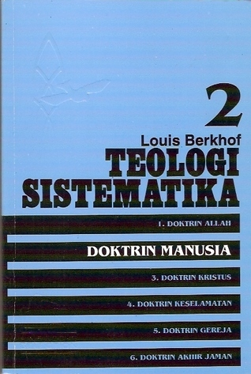
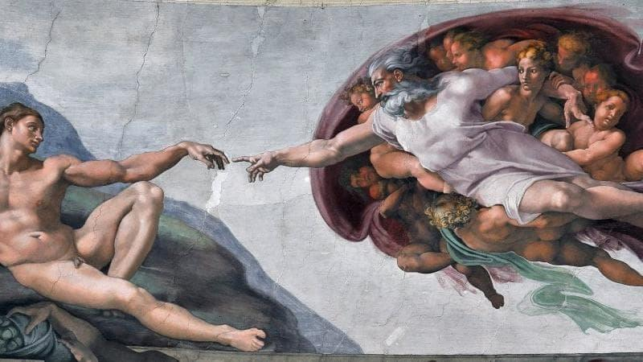

# Doktrin Manusia (Antropologi Teologis)

Berdasarkan Louis Berkhof – Teologi Sistematika Jilid 2: Doktrin Manusia

## 1. Pengertian antropologi teologis

🔵 Antropologi teologis (Theological Anthropology) adalah cabang teologi sistematika yang mempelajari manusia berdasarkan penyataan Allah dalam Alkitab.

🔵 Dalam pemikiran Louis Berkhof, doktrin manusia merupakan bagian penting dalam teologi sistematika karena manusia bukan hanya bagian dari ciptaan Allah, melainkan juga objek perhatian, pemeliharaan, dan karya penebusan Allah.

Pembahasan mengenai manusia secara alami mengikuti pembahasan mengenai Allah. Setelah memahami siapa Allah sebagai Pencipta, manusia perlu memahami siapa dirinya sebagai ciptaan dan bagaimana hubungannya dengan Allah.

Antropologi teologis berbeda dengan antropologi umum.

| Antropologi umum                                         | Antropologi teologis                                             |
| -------------------------------------------------------- | ---------------------------------------------------------------- |
| Mempelajari manusia melalui ilmu pengetahuan.            | Mempelajari manusia berdasarkan penyataan Allah.                 |
| Meneliti aspek biologis, sosial, budaya, dan psikologis. | Meneliti hakikat, asal-usul, tujuan, dan kondisi rohani manusia. |
| Menggunakan metode ilmiah dan empiris.                   | Menggunakan Alkitab sebagai sumber utama.                        |

🔵 Inti pemikiran Berkhof: Manusia hanya dapat memahami identitas, hakikat, dan tujuan hidupnya secara benar apabila ia memahami hubungannya dengan Allah.

---
## 2. Struktur pembahasan Doktrin Manusia 

Secara garis besar membagi pembahasan doktrin manusia menjadi tiga bagian utama:

1. **Manusia dalam Keadaannya yang Mula-Mula**
	- Membahas penciptaan manusia, natur manusia, gambar dan rupa Allah, serta perjanjian kerja.
2. **Manusia dalam Keadaan Berdosa**
	- Membahas asal mula dosa, hakikat dosa, pewarisan dosa, dosa dalam kehidupan manusia, dan hukuman dosa.
3. **Manusia dalam Perjanjian Anugerah**
	- Membahas konsep anugerah, perjanjian penebusan, hakikat perjanjian anugerah, dan berbagai dispensasi perjanjian.

Ketiga bagian tersebut memperlihatkan perjalanan pemahaman teologis mengenai manusia: manusia diciptakan dalam keadaan baik, jatuh ke dalam dosa, dan menerima pengharapan keselamatan melalui anugerah Allah.

---
# B. Bagian I – Manusia dalam Keadaannya yang Mula-Mula

## 1. Asal Mula Manusia

### a. 🔵 Manusia adalah ciptaan Allah

Manusia bukan hasil kebetulan atau keberadaan yang berdiri sendiri. Manusia merupakan ciptaan Allah yang secara khusus dibentuk menurut kehendak dan rancangan-Nya.

Dasar Alkitab:
- Kejadian 1:26–27 – Allah menciptakan manusia menurut gambar dan rupa-Nya.
- Kejadian 2:7 – Allah membentuk manusia dari debu tanah dan mengembuskan napas hidup.
- Mazmur 100:3 – Manusia adalah milik Allah karena Dia yang menjadikannya.

Penciptaan manusia memiliki beberapa karakteristik penting:
1. Berasal dari Allah: Manusia memiliki keberadaan karena kehendak dan kuasa Allah.
2. Memiliki identitas khusus: Manusia diciptakan menurut gambar dan rupa Allah.
3. Memiliki tujuan: Manusia diciptakan untuk hidup dalam hubungan dengan Allah dan menjalankan tanggung jawab dalam ciptaan.
4. Memiliki ketergantungan: Manusia bukan makhluk yang otonom secara mutlak, melainkan selalu bergantung kepada Penciptanya.

### b. 🔵 Penciptaan laki-laki dan perempuan

Manusia diciptakan sebagai laki-laki dan perempuan. Kejadian 1:27 menyatakan bahwa Allah menciptakan manusia menurut gambar-Nya, laki-laki dan perempuan diciptakan-Nya.

Hal ini mengandung beberapa makna teologis:
- Laki-laki dan perempuan sama-sama memiliki martabat sebagai gambar Allah.
- Keduanya memiliki tanggung jawab terhadap Allah.
- Keduanya dipanggil untuk menjalankan mandat Allah di dalam dunia.
- ‼️ Relasi manusia merupakan bagian dari rancangan penciptaan Allah.

### c. 🔵 Tujuan penciptaan manusia

Manusia diciptakan bukan hanya untuk memenuhi kebutuhan biologis atau menjalani kehidupan duniawi.

‼️ Tujuan penciptaan manusia berkaitan dengan:
- Memuliakan Allah.
- Hidup dalam persekutuan dengan Allah.
- Melaksanakan kehendak Allah.
- Mengelola dan memelihara ciptaan.
- Menjalankan mandat budaya.

Dasar Alkitab: Kejadian 1:28; Yesaya 43:7; Kolose 1:16.

‼️ Manusia adalah ciptaan Allah yang memiliki martabat, tujuan, dan tanggung jawab. Identitas manusia tidak dapat dipisahkan dari hubungannya dengan Allah.

---
## 2. Natur Manusia

Topik ini membahas unsur-unsur yang membentuk keberadaan manusia.

Terdapat dua pandangan utama dalam sejarah pemikiran Kristen mengenai struktur manusia, yaitu dikotomi dan trikotomi.

### a. 🔵 Pandangan trikotomi (Trichotomy)

Trikotomi merupakan pandangan bahwa manusia terdiri dari tiga unsur:
1. Tubuh (body).
2. Jiwa (soul).
3. Roh (spirit).

Dalam pandangan ini, jiwa dan roh dianggap mempunyai fungsi atau aspek yang dapat dibedakan.

Dasar Alkitab:
- 1 Tesalonika 5:23 → Paulus menyebutkan roh, jiwa, dan tubuh ketika berdoa agar seluruh keberadaan manusia dipelihara dengan sempurna sampai kedatangan Kristus.
- Ibrani 4:12 → jiwa dan roh merupakan dua aspek yang dapat dibedakan.
- 1 Korintus 2:14–15 → Paulus membedakan manusia duniawi (_natural man_) dengan manusia rohani (_spiritual man_).

### b. 🔵 Pandangan dikotomi (Dichotomy)

Dikotomi merupakan pandangan bahwa natur manusia terdiri dari dua unsur utama:
1. Tubuh (body): Unsur material yang bersifat jasmani.
2. Jiwa atau roh (soul/spirit): Unsur nonmaterial yang berkaitan dengan kehidupan batin manusia.

Dalam pandangan ini, jiwa dan roh tidak dipandang sebagai dua substansi yang berbeda secara mendasar, tetapi tidak dapat dipahami secara terpisah dari kesatuan pribadi manusia.

Dikotomi tidak mengajarkan bahwa tubuh lebih rendah daripada jiwa atau roh. Keduanya merupakan bagian dari rancangan penciptaan Allah. Karena itu, manusia harus dipahami sebagai kesatuan tubuh dan jiwa yang diciptakan untuk hidup dalam hubungan dengan Allah.

Dasar Alkitab:
- Kejadian 2:7 → Allah membentuk manusia dari debu tanah dan mengembuskan napas hidup ke dalam hidungnya sehingga manusia menjadi makhluk yang hidup.
- Matius 10:28 → Yesus membedakan tubuh yang dapat dibunuh manusia dengan jiwa yang tidak dapat dibunuh manusia.
- Pengkhotbah 12:7 → Tubuh kembali menjadi debu tanah, sedangkan roh kembali kepada Allah yang mengaruniakannya.
- 1 Korintus 5:3–5 → Paulus menggunakan istilah roh dan tubuh ketika membahas keberadaan manusia, yang menunjukkan adanya dimensi jasmani dan non jasmani.

>🎓 apa yang Anda percaya tentang natur manusia?

### c. 🔵 Pandangan Berkhof

Berkhof menerima pandangan dikotomi. Ia berpendapat bahwa Alkitab pada dasarnya mengajarkan dua unsur konstitusional manusia, yaitu unsur material dan nonmaterial.

Namun, hal ini tidak berarti manusia merupakan dua bagian yang terpisah dan tidak berhubungan.

**Manusia harus dipahami sebagai satu kesatuan yang utuh.**

| Aspek | Penjelasan                                                                          |
| ----- | ----------------------------------------------------------------------------------- |
| Tubuh | Aspek material manusia yang berhubungan dengan dunia fisik.                         |
| Jiwa  | Aspek nonmaterial yang berkaitan dengan kehidupan batin dan kesadaran.              |
| Roh   | Istilah yang dalam Alkitab juga digunakan untuk menunjuk aspek nonmaterial manusia. |

>🧑‍🏫 yang penting adalah memahami apa implikasinya kepada kehidupan kita.

#### Pandangan Berkhof terhadap trikotomi

Berkhof memberikan perhatian pada 1 Tesalonika 5:23 yang sering digunakan sebagai dasar trikotomi.

Dalam ayat tersebut, Paulus menyebut roh, jiwa, dan tubuh.

Namun, Berkhof berpendapat bahwa penyebutan ketiganya dapat dipahami sebagai cara untuk menekankan seluruh keberadaan manusia.

Dengan kata lain, ayat tersebut tidak harus ditafsirkan sebagai bukti bahwa manusia terdiri dari tiga substansi.

Hal ini serupa dengan cara Alkitab menggunakan beberapa istilah untuk menggambarkan keseluruhan pribadi manusia.

---
## 3. Manusia sebagai Gambar dan Rupa Allah

🔵 Salah satu pembahasan paling penting dalam antropologi teologis Berkhof adalah manusia sebagai gambar dan rupa Allah (Image of God / Imago Dei).

Dasar utama: Kejadian 1:26–27.

Allah berfirman bahwa manusia diciptakan menurut gambar dan rupa-Nya.

Pertanyaan penting yang perlu dijawab adalah: Apa makna manusia diciptakan menurut gambar dan rupa Allah?

### a. 🔵 Pengertian Imago Dei

*Imago Dei* berarti gambar Allah. Istilah ini menjelaskan bahwa manusia memiliki karakteristik tertentu yang mencerminkan Allah sebagai Penciptanya.

Menurut Berkhof, gambar Allah pada manusia harus dipahami dalam dua pengertian.

#### 1. Gambar Allah dalam pengertian luas (Broad Sense)

Gambar Allah mencakup seluruh aspek keberadaan manusia sebagai pribadi yang diciptakan Allah.

Misalnya:
- Rasionalitas dan kemampuan berpikir.
- Kehendak dan kebebasan moral.
- Kemampuan berkomunikasi.
- Kesadaran diri.
- Kemampuan menjalin relasi.
- Natur rohani manusia.

Aspek ini membedakan manusia dari makhluk ciptaan lainnya dalam kedudukannya sebagai pribadi.

>🧑‍🏫 manusia "bukan sekedar" mahluk hidup. Ini sebabnya mengapa manusia diperlakukan berbeda dengan binatang dan kita harus menghormati sesama, karena mereka adalah *gambar Allah*.

#### 2. 🔵 Gambar Allah dalam pengertian sempit (Narrow Sense)

Dalam pengertian sempit, gambar Allah terutama menunjuk pada kualitas moral dan rohani manusia sebelum kejatuhan ke dalam dosa.

Berkhof menghubungkannya dengan:
- Pengetahuan yang benar.
- Kebenaran.
- Kekudusan.

Dasar Alkitab: Kolose 3:10 dan Efesus 4:24.

Ketiga aspek tersebut menggambarkan kondisi manusia sebelum kejatuhan, ketika manusia hidup dalam keselarasan dengan kehendak Allah.

### 🔵 b. Dampak dosa terhadap gambar Allah

Ketika manusia jatuh ke dalam dosa, gambar Allah mengalami kerusakan. Namun, kerusakan tersebut tidak berarti gambar Allah sepenuhnya hilang.

Ada dua hal yang harus dibedakan:

| Aspek               | Sebelum kejatuhan                         | Setelah kejatuhan                                                 |
| ------------------- | ----------------------------------------- | ----------------------------------------------------------------- |
| Rasionalitas        | Diciptakan dengan kemampuan berpikir.     | Tetap memiliki kemampuan berpikir, tetapi dapat dipengaruhi dosa. |
| Kehendak            | Memiliki kebebasan untuk menaati Allah.   | Kehendak telah dipengaruhi dan diperbudak dosa.                   |
| Moralitas           | Diciptakan dalam kebenaran dan kekudusan. | Mengalami kerusakan moral.                                        |
| Relasi dengan Allah | Hidup dalam persekutuan dengan Allah.     | Mengalami keterpisahan secara rohani.                             |
| Gambar Allah        | Dalam keadaan awal yang baik.             | Tetap ada, tetapi telah mengalami kerusakan.                      |

### c. 🔵 Pemulihan gambar Allah

Melalui karya keselamatan Kristus, manusia mengalami proses pemulihan gambar Allah.

Dasar Alkitab:
- Roma 8:29.
- Kolose 3:10.
- Efesus 4:24.

Pemulihan tersebut berkaitan dengan proses pengudusan, yaitu pembaruan manusia agar semakin menyerupai Kristus melalui karya penebusan yang dikerjakan-Nya

---
## 4. Manusia dalam Perjanjian Kerja (Covenant of Works / Foedus Operum)

Berkhof membahas bahwa hubungan Allah dengan manusia pada awal penciptaan dapat dipahami melalui konsep perjanjian kerja.

### a. 🔵 Pengertian perjanjian kerja

Perjanjian kerja merupakan konsep teologis yang menjelaskan hubungan antara Allah dan Adam sebagai wakil umat manusia sebelum kejatuhan dalam dosa.

Dalam perjanjian tersebut terdapat beberapa unsur:
1. Allah sebagai pihak yang menetapkan perjanjian.
2. Adam sebagai wakil umat manusia.
3. Ketaatan kepada perintah Allah sebagai tuntutan.
4. Kehidupan sebagai berkat yang dijanjikan.
5. Kematian sebagai konsekuensi pelanggaran.

Dasar Alkitab: Kejadian 2:16–17; Roma 5:12–19.

### b. Unsur-unsur perjanjian kerja

| Unsur                 | Penjelasan                                                             |
| --------------------- | ---------------------------------------------------------------------- |
| Pihak yang mengadakan | Allah dan Adam sebagai wakil manusia.                                  |
| Tuntutan              | Ketaatan terhadap perintah Allah.                                      |
| Larangan              | Tidak memakan buah pohon pengetahuan tentang yang baik dan yang jahat. |
| Janji                 | Kehidupan sebagai konsekuensi ketaatan.                                |
| Sanksi                | Kematian sebagai konsekuensi ketidaktaatan.                            |

### c. 🔵 Signifikansi perjanjian kerja

Konsep ini memiliki arti penting dalam teologi Reformed karena menjelaskan:
- Hubungan antara ketaatan dan kehidupan.
- Tanggung jawab manusia terhadap Allah.
- Adam sebagai wakil umat manusia.
- Hubungan antara kejatuhan Adam dan dosa manusia.
- Hubungan antara Adam dan Kristus sebagai dua representasi manusia dalam sejarah keselamatan.

---
# C. Bagian II – Manusia dalam Keadaan Berdosa

Bagian kedua merupakan pembahasan tentang perubahan kondisi manusia setelah kejatuhan ke dalam dosa.

Berkhof menekankan bahwa dosa bukan sekadar tindakan pelanggaran individual, tetapi merupakan persoalan mendasar yang memengaruhi seluruh keberadaan manusia.

## 1. Asal Mula Dosa (The Origin of Sin)

### a. 🔵 Pengertian asal mula dosa

Dosa memasuki kehidupan manusia melalui pelanggaran Adam dan Hawa terhadap perintah Allah.

Kejadian 3 menjelaskan bagaimana manusia tergoda oleh Iblis, meragukan firman Allah, dan akhirnya memilih untuk tidak menaati perintah-Nya.

Peristiwa ini dikenal sebagai kejatuhan manusia (The Fall of Man).

### b. Proses kejatuhan manusia

1. Pencobaan
	- Manusia menghadapi godaan untuk meragukan firman Allah.
2. Keraguan
	- Manusia mulai mempertanyakan kebenaran dan otoritas Allah.
3. Ketidaktaatan
	- Manusia melanggar perintah Allah dengan memakan buah terlarang.
4. Kejatuhan
	- Dosa masuk ke dalam kehidupan manusia.
5. Konsekuensi dosa
	- Kematian, keterpisahan dari Allah, kerusakan moral, dan penderitaan.

### c. 🔵 Akibat kejatuhan manusia

Kejatuhan manusia menghasilkan beberapa konsekuensi:
1. Kerusakan hubungan manusia dengan Allah.
2. Kerusakan hubungan manusia dengan sesamanya.
3. Kerusakan hubungan manusia dengan alam.
4. Munculnya penderitaan dan kematian.
5. Kerusakan natur moral manusia.

Dasar Alkitab: Kejadian 3; Roma 5:12; Roma 6:23.

---
## 2. Karakter Esensial Dosa (The Essential Character of Sin)

### a. 🔵 Pengertian dosa

Menurut Berkhof, dosa pada hakikatnya merupakan pelanggaran terhadap hukum Allah.

Dosa bukan sekadar kesalahan sosial, tindakan tidak bermoral, atau pelanggaran terhadap aturan manusia.

Dosa adalah pemberontakan manusia terhadap otoritas dan kehendak Allah.

Dasar Alkitab:
- 1 Yohanes 3:4 – Dosa berhubungan dengan pelanggaran hukum.
- Roma 3:23 – Semua manusia telah berbuat dosa.
- Yakobus 4:17 – Mengetahui yang baik tetapi tidak melakukannya juga merupakan dosa.

### b. 🔵 Karakteristik dosa

Beberapa karakteristik dosa menurut kerangka pemikiran Berkhof:

1. Dosa memiliki sifat moral dan rohani.
	- Dosa berkaitan dengan hubungan manusia terhadap Allah, bukan sekadar perilaku yang dinilai buruk oleh masyarakat.
	- 🧑‍🏫 Keberadaan dosa adalah salah satu hal yang menjelaskan *mengapa kejahatan ada di dunia*.

2. Dosa merupakan pelanggaran terhadap hukum Allah.
	- Allah adalah standar tertinggi kebenaran. Karena itu, dosa harus dipahami berdasarkan kehendak dan hukum-Nya.
	- 🎓 apa saja hal yang tidak melanggar hukum negara, tapi kita menyebutnya itu dosa, dan mengapa.

3. Dosa memiliki dimensi internal dan eksternal.
	- Dosa tidak hanya muncul dalam tindakan, tetapi juga dalam pikiran, motivasi, keinginan, dan sikap hati manusia.

4. Dosa bersifat universal.
	- Seluruh manusia tanpa terkecuali telah berada dalam kondisi berdosa dan berada di bawah pengaruh dosa. ([Roma 3:23](https://alkitab.sabda.org/passage.php?passage=roma%203:23), [Roma 5:12](https://alkitab.sabda.org/passage.php?passage=Roma%205:12))

### c. Dosa sebagai kondisi dan tindakan

Dalam teologi sistematika, dosa dapat dipahami melalui dua dimensi:
- Original Sin: Kondisi keberdosaan yang diwarisi manusia akibat kejatuhan Adam.
- Actual Sin: Dosa yang dilakukan manusia melalui pikiran, perkataan, dan perbuatannya.

Perbedaan ini penting untuk memahami bahwa manusia bukan hanya melakukan dosa, tetapi juga berada dalam kondisi natur yang telah rusak oleh dosa.

---
## 3. Transmisi Dosa (The Transmission of Sin)

Topik ini membahas bagaimana dosa Adam berkaitan dengan kondisi keberdosaan seluruh umat manusia.

### a. Pengertian transmisi dosa

Transmisi dosa adalah proses atau konsep teologis yang menjelaskan bagaimana dosa yang dilakukan Adam berdampak terhadap keturunannya.

Berkhof membahas hubungan antara Adam sebagai manusia pertama dan seluruh umat manusia.

Dasar Alkitab: Roma 5:12–19.

### b. Dua aspek dosa asal

Berkhof membedakan dosa asal ke dalam dua aspek utama:

1. Kesalahan karena dosa (Original Guilt)
	- Manusia berada dalam kondisi bersalah di hadapan Allah karena hubungan representatif Adam dengan umat manusia.
	- Dalam kerangka teologi Reformed, Adam dipandang sebagai kepala perwakilan umat manusia dalam perjanjian kerja.

2. Kerusakan natur (Original Pollution)
	- Manusia mewarisi natur yang telah rusak akibat kejatuhan.
	- Kerusakan ini memengaruhi seluruh aspek keberadaan manusia.
	- Misalnya:
		- Pikiran manusia cenderung dipengaruhi dosa.
		- Kehendak manusia tidak lagi sepenuhnya selaras dengan kehendak Allah.
		- Perasaan dan keinginan manusia dapat mengarah kepada hal-hal yang bertentangan dengan kehendak Allah.
		- Hubungan manusia dengan Allah mengalami kerusakan.

### c. Kerusakan total manusia (Total Depravity)

Salah satu konsep penting dalam teologi Reformed adalah kerusakan total.

Kerusakan total bukan berarti setiap manusia selalu melakukan kejahatan secara maksimal.

Sebaliknya, konsep ini berarti bahwa dosa telah memengaruhi seluruh aspek keberadaan manusia.

| Aspek manusia | Dampak dosa                                                                |
| ------------- | -------------------------------------------------------------------------- |
| Intelektual   | Pikiran mengalami kerusakan dan tidak sepenuhnya memahami kebenaran Allah. |
| Kehendak      | Kehendak cenderung menentang Allah.                                        |
| Emosional     | Perasaan dan keinginan dapat dikuasai oleh dosa.                           |
| Moral         | Manusia kehilangan kebenaran dan kekudusan semula.                         |
| Spiritual     | Manusia mengalami keterpisahan dari Allah.                                 |

Dasar Alkitab: Roma 3:10–18; Efesus 2:1–3; Yeremia 17:9.

--- 
## 4. Dosa dalam Kehidupan Umat Manusia

Dosa bukan hanya peristiwa historis yang terjadi di Taman Eden. Dosa terus memengaruhi kehidupan manusia sepanjang sejarah.

Berkhof membahas bagaimana dosa berkembang dan memanifestasikan dirinya dalam kehidupan manusia.

### a. 🔵 Dosa dalam kehidupan individu

Dosa memengaruhi kehidupan manusia melalui:
- Pikiran dan motivasi.
- Perkataan.
- Perbuatan.
- Hubungan interpersonal.
- Keputusan moral.
- Hubungan dengan Allah.

### b. 🔵 Dosa dalam kehidupan sosial

Dosa juga memengaruhi kehidupan bersama.

Contohnya:
1. Ketidakadilan sosial.
2. Kekerasan.
3. Keserakahan.
4. Korupsi.
5. Penindasan.
6. Konflik antarmanusia.

### c. 🔵 Dosa dan tanggung jawab manusia

Walaupun manusia memiliki natur berdosa, manusia tetap bertanggung jawab atas tindakan moralnya di hadapan Allah.

Manusia tidak dapat menggunakan kondisi keberdosaannya sebagai alasan untuk membenarkan perbuatan dosa.

Dasar Alkitab: Roma 2:6–8; Galatia 5:19–21.

---
## 5. Hukuman atas Dosa (The Punishment of Sin)

### a. Pengertian hukuman dosa

Hukuman dosa merupakan konsekuensi yang ditetapkan Allah terhadap pelanggaran manusia.

Karena Allah adalah kudus dan adil, dosa tidak dapat dipandang sebagai persoalan yang tidak memiliki konsekuensi.

### b. 🔵 Bentuk hukuman dosa

Berkhof menjelaskan konsekuensi dosa dalam beberapa dimensi.

1. Kematian rohani
	- Manusia mengalami keterpisahan dalam hubungannya dengan Allah.
	- Dasar Alkitab: Efesus 2:1.

2. Penderitaan jasmani
	- Kejatuhan membawa penderitaan, kelemahan, penyakit, dan kematian fisik.
	- Dasar Alkitab: Kejadian 3:16–19.

3. Kematian kekal
	- Kematian kekal merupakan hukuman akhir bagi manusia yang berada di bawah penghukuman dosa.
	- Dasar Alkitab: Roma 6:23; Wahyu 20:11–15.

4. Konsekuensi dalam kehidupan sosial dan alam
	- Dosa membawa kerusakan dalam relasi manusia dengan sesamanya dan dengan lingkungan ciptaan.
	- Dasar Alkitab: Kejadian 3:17–18; Roma 8:20–22.

Kesimpulan Bagian II: Dosa telah merusak seluruh keberadaan manusia. Karena itu, manusia tidak dapat menyelamatkan dirinya sendiri melalui kemampuan, moralitas, atau perbuatan baiknya.

---
# D. Bagian III – Manusia dalam Perjanjian Anugerah

Bagian ketiga menjelaskan bagaimana Allah menyediakan jalan keselamatan bagi manusia yang telah jatuh ke dalam dosa.

Berkhof menempatkan pembahasan perjanjian anugerah dalam kerangka sejarah penebusan dan hubungan Allah dengan umat-Nya.

## 1. Istilah dan Konsep Anugerah (Grace)

### a. 🔵Pengertian anugerah

Anugerah (grace) adalah kebaikan dan kemurahan Allah yang diberikan kepada manusia bukan karena manusia layak menerimanya, melainkan berdasarkan kasih dan kehendak Allah.

‼️ Dalam konteks keselamatan, anugerah menunjukkan bahwa manusia tidak dapat memperoleh keselamatan berdasarkan prestasi atau perbuatannya sendiri.

Dasar Alkitab:
- Efesus 2:8–9.
- Roma 3:24.
- Titus 3:5.

### b. 🔵 Karakteristik anugerah Allah

Karakteristik anugerah Allah dalam konteks keselamatan

1. Tidak berdasarkan kelayakan manusia.
	- Manusia menerima keselamatan bukan karena jasa atau prestasinya.

2. Bersumber dari Allah.
	- Keselamatan merupakan inisiatif dan karya Allah.

3. Berkaitan dengan penebusan Kristus.
	- Anugerah Allah dinyatakan secara nyata melalui kematian dan kebangkitan Yesus Kristus.

4. Menghasilkan kehidupan yang diperbarui.
	- Anugerah tidak hanya menyelamatkan manusia dari hukuman dosa, tetapi juga menghasilkan kehidupan yang semakin sesuai dengan kehendak Allah.

---
## 2. Perjanjian Penebusan (Covenant of Redemption)

### a. Pengertian perjanjian penebusan

Perjanjian penebusan merupakan konsep teologis dalam tradisi Reformed yang menjelaskan kesepakatan kekal dalam karya keselamatan antara pribadi-pribadi Tritunggal.

Konsep ini membahas rancangan keselamatan Allah sebelum pelaksanaannya dalam sejarah manusia.

Dalam kerangka ini:
- Bapa menetapkan dan mengutus Anak.
- Anak menjalankan karya penebusan melalui inkarnasi, ketaatan, penderitaan, kematian, dan kebangkitan.
- Roh Kudus menerapkan karya keselamatan kepada umat pilihan.

Perlu diperhatikan bahwa pembagian ini menjelaskan perbedaan peran dalam karya keselamatan, bukan pemisahan kehendak atau tindakan di antara ketiga pribadi Tritunggal.

Dasar Alkitab: Yohanes 6:37–40; Efesus 1:3–14; Yohanes 17:4–5.

### b. Tujuan perjanjian penebusan

Tujuan utama perjanjian penebusan adalah keselamatan umat Allah melalui karya Kristus.

Hal ini menunjukkan bahwa keselamatan bukan rencana darurat setelah manusia jatuh ke dalam dosa, melainkan bagian dari rancangan kekal Allah.

---
## 3. Natur Perjanjian Anugerah (The Nature of the Covenant of Grace)

### a. Pengertian perjanjian anugerah

Perjanjian anugerah merupakan perjanjian yang ditetapkan Allah untuk memberikan keselamatan kepada manusia berdosa melalui Yesus Kristus.

Berbeda dengan perjanjian kerja yang menekankan ketaatan Adam sebagai wakil manusia, perjanjian anugerah menekankan keselamatan yang disediakan Allah melalui karya Kristus.

### b. Unsur-unsur perjanjian anugerah

| Unsur                 | Penjelasan                                    |
| --------------------- | --------------------------------------------- |
| Pihak yang menetapkan | Allah.                                        |
| Penerima              | Manusia berdosa yang menjadi umat perjanjian. |
| Mediator              | Yesus Kristus.                                |
| Dasar keselamatan     | Anugerah Allah dan karya penebusan Kristus.   |
| Respons manusia       | Iman dan kehidupan dalam ketaatan.            |
| Tujuan                | Keselamatan dan persekutuan dengan Allah.     |

### c. Kristus sebagai Mediator

Dalam perjanjian anugerah, Yesus Kristus memiliki posisi yang sangat penting sebagai Mediator atau Pengantara antara Allah dan manusia.

Dasar Alkitab:
- 1 Timotius 2:5.
- Ibrani 8:6.
- Ibrani 9:15.

Kristus menjalankan karya penebusan dengan menanggung hukuman dosa dan mendamaikan manusia dengan Allah.

Dengan demikian, keselamatan manusia tidak bergantung pada kemampuan manusia memenuhi tuntutan kesempurnaan Allah, melainkan pada karya Kristus.

---
## 4. Aspek Ganda Perjanjian Anugerah

Dalam pembahasan Berkhof, perjanjian anugerah memiliki aspek yang berkaitan dengan Allah dan manusia.

Secara teologis, perjanjian ini memiliki dua dimensi penting:

1. Aspek eksternal
	- Perjanjian anugerah dinyatakan dalam sejarah melalui pemberitaan firman, tanda-tanda perjanjian, dan kehidupan umat perjanjian.
	- Aspek ini berkaitan dengan keberadaan umat Allah yang terlihat dalam sejarah.

2. Aspek internal
	- Aspek internal berhubungan dengan karya anugerah Allah di dalam hati manusia melalui Roh Kudus.
	- Hal ini mencakup:
		- Pembaruan hati.
		- Iman kepada Kristus.
		- Pertobatan.
		- Pembaruan kehidupan.
		- Persekutuan dengan Allah.

Pembedaan ini penting karena keanggotaan dalam komunitas perjanjian yang kelihatan tidak secara otomatis berarti setiap orang telah mengalami keselamatan secara pribadi.

---
## 5. 🔵 Perjanjian Anugerah dalam Sejarah Keselamatan

Perjanjian anugerah memiliki perkembangan dan bentuk penyataan yang berbeda sepanjang sejarah keselamatan. Perjanjian anugerah dipahami sebagai satu kesatuan dalam berbagai tahap sejarah.

Beberapa tahap penting yang dapat dipelajari:

| Tahap sejarah             | Penjelasan                                                                                        |
| ------------------------- | ------------------------------------------------------------------------------------------------- |
| Setelah kejatuhan         | Janji keselamatan mulai dinyatakan dalam Kejadian 3:15.                                           |
| Perjanjian dengan Nuh     | Allah menyatakan pemeliharaan dan janji-Nya terhadap ciptaan (Kejadian 9).                        |
| Perjanjian dengan Abraham | Janji Allah mengenai keturunan dan berkat bagi bangsa-bangsa (Kejadian 12, 15, 17).               |
| Perjanjian dengan Israel  | Allah menyatakan hubungan perjanjian dengan umat-Nya melalui Musa.                                |
| Perjanjian Daud           | Allah menjanjikan keturunan dan kerajaan yang memiliki penggenapan mesianik.                      |
| Perjanjian Baru           | Keselamatan dinyatakan melalui karya Kristus dan penggenapan janji Allah (Lukas 22:20; Ibrani 8). |

> 🧑‍🏫 Cerita yang tertulis dalam Alkitab itu bukan sekedar untuk menyampaikan pesan moral.

Seluruh kisah dalam Alkitab menunjukkan kesinambungan rencana keselamatan Allah dalam sejarah. Semua tahap tersebut mengarah kepada penggenapan karya keselamatan di dalam Yesus Kristus.

🎓 Bagaimana melihat kisah-kisah berikut dalam rencana kesalamatan Allah?
- Kisah Israel keluar dari Mesir
- Kisah para hakim (dalam kitab Hakim-hakim)
- Kisah Ester 

---
# E. Sintesis: Hubungan Tiga Keadaan Manusia dalam Teologi Berkhof

Setelah memahami ketiga bagian, mahasiswa perlu melihat hubungan antara penciptaan, kejatuhan, dan anugerah sebagai satu kesatuan pemikiran teologis.

## Perjalanan manusia dalam perspektif teologi Reformed

1. Penciptaan (Kejadian 1–2) : Manusia dalam keadaan mula-mula
	- Diciptakan menurut gambar Allah.
	- Memiliki pengetahuan, kebenaran, dan kekudusan.
	- Hidup dalam hubungan dengan Allah.
	- Memiliki tanggung jawab menjalankan kehendak Allah.

2. Kejatuhan (Kejadian 3; Roma 5:12–19) : Manusia dalam keadaan berdosa 
	- Melanggar perintah Allah.
	- Gambar Allah mengalami kerusakan.
	- Natur manusia menjadi berdosa.
	- Mengalami kematian dan keterpisahan dari Allah.

3. Penebusan (Efesus 2:8–10; Roma 8:29) : Manusia dalam perjanjian anugerah
	- Allah menyediakan keselamatan.
	- Kristus menjadi Mediator.
	- Manusia diselamatkan melalui anugerah.
	- Manusia mengalami pembaruan dan pemulihan.
	    
Tiga keadaan tersebut dapat diringkas melalui tabel berikut.

|Aspek|Penciptaan|Kejatuhan|Anugerah|
|---|---|---|---|
|Kondisi manusia|Baik|Berdosa|Diperbarui|
|Hubungan dengan Allah|Harmonis|Terpisah|Diperdamaikan|
|Gambar Allah|Baik dan utuh|Rusak|Dipulihkan|
|Kehendak|Selaras dengan Allah|Dipengaruhi dosa|Diperbarui|
|Keselamatan|Belum diperlukan karena belum jatuh|Tidak mampu menyelamatkan diri|Melalui Kristus|

---
# F. Kesimpulan Umum Doktrin Manusia

Berdasarkan pemikiran Louis Berkhof, terdapat lima kesimpulan utama yang perlu dipahami mahasiswa.

1. Manusia adalah ciptaan Allah.
	- Manusia bukan makhluk yang berdiri sendiri. Keberadaan, identitas, dan tujuan hidup manusia bergantung kepada Allah sebagai Pencipta.

2. Manusia diciptakan menurut gambar dan rupa Allah.
	- Manusia memiliki martabat dan tanggung jawab khusus di antara seluruh ciptaan. Gambar Allah menjadi dasar pemahaman mengenai nilai dan kedudukan manusia.

3. Dosa merusak seluruh keberadaan manusia.
	- Kejatuhan Adam membawa konsekuensi yang memengaruhi pikiran, kehendak, perasaan, moralitas, dan hubungan manusia dengan Allah.

4. Manusia tidak dapat menyelamatkan dirinya sendiri.
	- Kerusakan akibat dosa menyebabkan manusia membutuhkan pertolongan dan keselamatan yang berasal dari Allah.

5. Keselamatan merupakan karya anugerah Allah melalui Kristus.
	- Perjanjian anugerah memperlihatkan bahwa Allah menyediakan jalan keselamatan melalui Yesus Kristus sebagai Mediator.

Dengan demikian, doktrin manusia tidak hanya membahas siapa manusia, tetapi juga menjelaskan mengapa manusia membutuhkan keselamatan dan bagaimana Allah memulihkan manusia melalui karya penebusan Kristus.

---
# 🎓 Diskusi & Tugas

Berikut pertanyaan yang dapat digunakan sebagai bahan diskusi kelas maupun evaluasi pembelajaran.

### Pertanyaan pemahaman

1. Apa yang dimaksud dengan antropologi teologis menurut perspektif Louis Berkhof?
2. Mengapa pembahasan doktrin manusia ditempatkan setelah doktrin Allah?
3. Jelaskan perbedaan pandangan dikotomi dan trikotomi mengenai natur manusia.
4. Apa yang dimaksud dengan Imago Dei?
5. Jelaskan pengertian perjanjian kerja (Covenant of Works).
6. Apa yang dimaksud dengan dosa asal (Original Sin)?
7. Jelaskan konsep kerusakan total (Total Depravity).
8. Apa perbedaan perjanjian kerja dan perjanjian anugerah?
9. Mengapa Yesus Kristus disebut sebagai Mediator dalam perjanjian anugerah?
10. Bagaimana karya Kristus memulihkan manusia yang telah jatuh ke dalam dosa?

### Pertanyaan analisis dan diskusi

1. Jika manusia diciptakan menurut gambar Allah, bagaimana konsep tersebut seharusnya memengaruhi cara manusia memperlakukan sesamanya?
2. Apakah manusia masih memiliki kehendak bebas setelah kejatuhan ke dalam dosa? Jelaskan berdasarkan perspektif Berkhof.
3. Bagaimana doktrin kerusakan total menjelaskan fenomena korupsi, ketidakadilan, dan kekerasan dalam masyarakat?
4. Mengapa manusia tidak dapat memperoleh keselamatan melalui perbuatan baik?
5. Bagaimana konsep perjanjian anugerah memberikan pengharapan bagi manusia yang hidup dalam dosa?

---
---
