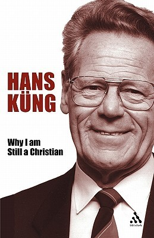

Buku _Why I Am Still a Christian_ karya Hans Küng mengeksplorasi relevansi iman Kristen di tengah krisis nilai masyarakat modern, memberikan kritik tajam terhadap institusi gereja, dan menyerukan persatuan ekumenis yang konkret.

Di tengah disorientasi kontemporer yang diakibatkan oleh runtuhnya otoritas tradisional, rasionalitas murni terbukti tidak memadai untuk menetapkan moralitas yang mengikat. Küng berargumen bahwa agama, khususnya tradisi Kekristenan sejati, tetap krusial sebagai fondasi etis yang mutlak untuk menjamin komitmen terhadap martabat manusia, kebebasan, dan keadilan.

Penulis membedakan dengan tegas antara sejarah kelam serta sikap legalistik gereja institusional ("Kekristenan nominal") dengan inti ajaran Yesus ("Kekristenan sejati"). Ia secara terbuka mengkritik berbagai kebijakan hierarki Katolik Roma—seperti larangan kontrasepsi buatan, penolakan komuni bagi umat yang bercerai dan menikah lagi, pemaksaan selibat bagi klerus, serta penolakan tahbisan perempuan—sebagai belenggu yang bertentangan dengan semangat welas asih dan inklusivitas Yesus.

Komitmen Kristen penulis berakar pada Allah yang diwahyukan oleh Yesus Kristus: bukan sosok diktator atau hakim yang menghukum, melainkan Bapa yang penuh kasih yang selalu memihak kaum lemah, berdosa, dan terpinggirkan. Melalui teladan Yesus, penderitaan-Nya di salib, dan kebangkitan-Nya, Kekristenan memberikan rasionalitas untuk menghadapi realitas negatif kehidupan dan memberikan harapan yang masuk akal bahwa kematian bermuara pada Allah, bukan ketiadaan. Keselamatan tidak dinilai dari kesuksesan duniawi, melainkan dari pembenaran melalui iman dan kepercayaan mutlak pada kasih karunia Allah.

Küng juga memberikan sorotan tajam pada isu perpecahan denominasi, mempertanyakan "Apakah Kristus terbagi?" dengan mengacu pada surat Paulus kepada jemaat di Korintus. Mengingat konsensus teologis antar-gereja yang telah dicapai, seperti yang tertuang dalam Deklarasi Lima tentang pembaptisan dan ekaristi, Küng mendesak gereja Katolik, Ortodoks, dan Protestan untuk segera menyingkirkan ego institusional, mengakui pelayanan satu sama lain, dan mengizinkan perayaan Ekaristi bersama secara lintas denominasi tanpa penundaan lebih lanjut.

---

## Disorientation and Christian Commitment

- **Krisis Nilai dan Runtuhnya Otoritas:** Masyarakat modern sedang mengalami krisis nilai yang sangat mendalam sejak pemberontakan kaum muda pada akhir 1960-an. Otoritas dan institusi tradisional seperti negara, gereja, sekolah, dan keluarga tidak lagi diterima tanpa dipertanyakan.
    
- **Dampak Kebebasan yang Berlebihan:** Proses liberalisasi sering kali menghancurkan tabu dan membuat moralitas terasa relatif. Hal ini mengakibatkan banyak orang, terutama generasi muda, merasa kehilangan makna hidup sehingga berpaling pada kenakalan, sekte agama ekstrem, atau fanatisme politik.
    
- **Kegagalan Rasionalitas Murni:** Sangat sulit untuk membuktikan perlunya nilai-nilai moral (seperti mengapa keadilan lebih baik dari keegoisan, atau kedamaian lebih baik dari perang) hanya dengan mengandalkan akal atau rasionalitas filsafat semata.
    
- **Aturan vs. Orientasi Fundamental:** Masyarakat saat ini memiliki banyak aturan, regulasi, dan perencanaan, tetapi semua itu tidak sama dengan memiliki sistem nilai. Semakin banyak aturan yang ada, manusia justru semakin merasa disorientasi dan mendambakan komitmen terhadap nilai-nilai yang esensial.
    
- **Kompleksitas Masalah Modern:** Perubahan sosial terjadi sangat cepat, membawa masalah etis berskala besar seperti energi nuklir, rekayasa genetika, dan isu lingkungan, yang membebani pemahaman individu.
    
- **Kebutuhan akan Kompas Baru:** Di tengah kebingungan dan hilangnya arah ini, penulis berargumen bahwa umat manusia membutuhkan pijakan yang kuat. Nilai-nilai esensial Kristen ditawarkan sebagai kompas fundamental untuk menavigasi persoalan kehidupan individu maupun masyarakat modern.

---

## The Nominally Christian and the Truly Christian (Kekristenan yang Sekadar Nama dan Kekristenan Sejati):

- **Kebutuhan akan Nilai Fundamental dan Peran Agama:** Dalam krisis nilai saat ini, kehidupan bermasyarakat tidak mungkin berjalan tanpa adanya konsensus dasar mengenai norma dan etika. Karena etika moral sulit dijustifikasi hanya melalui rasionalitas murni, agama berperan penting dalam memberikan pijakan serta otoritas mutlak bagi kewajiban moral manusia, di mana nilai-nilai seperti martabat, kebebasan, dan keadilan secara historis diilhami oleh semangat Kristen.
    
- **Pengakuan terhadap Kegagalan Sejarah Gereja:** Penulis sangat memahami mengapa banyak orang (termasuk dirinya) menolak dogmatika yang otoriter dan moralitas yang sempit. Ia secara terbuka mengakui kegagalan kelam sejarah Kekristenan—mulai dari perang salib, pembakaran penyihir, peradilan Galileo, hingga keterlibatan gereja dengan penguasa yang menindas. Namun, ia menegaskan bahwa itu semua hanyalah Kekristenan palsu (pseudo-Christian) yang sangat bertentangan dengan ajaran Yesus.
    
- **Kritik Keras terhadap Kebijakan Vatikan Saat Ini:** Penulis meyakini bahwa Yesus dari Nazaret tidak akan setuju dengan sikap otoritas Gereja Katolik Roma saat ini pada berbagai isu krusial. Ia menyoroti larangan gereja terhadap kontrasepsi buatan, penolakan komuni bagi umat yang bercerai dan menikah lagi, larangan pernikahan bagi klerus, pelarangan tahbisan perempuan, serta sikap yang tidak simpatik terhadap isu seksualitas pranikah dan homoseksualitas.
    
- **Kritik terhadap Kemunduran Ekumenisme dan Kebebasan Internal:** Yesus juga diyakini tidak akan mendukung sikap gereja yang menganggap perbedaan denominasi sebagai penghalang pernikahan, meragukan keabsahan Ekaristi Protestan, melarang perayaan Ekaristi bersama (interkomuni), atau upaya gereja untuk membungkam dan mendisiplinkan para teolog serta pihak-pihak kritis tanpa dialog yang rasional.
    
- **Berpegang pada Kekristenan Sejati:** Terlepas dari semua cacat institusional dan perilaku "Kekristenan nominal" tersebut, penulis menyatakan bahwa ia tetap bertahan. Di tengah zaman yang kehilangan arah ini, ia menemukan pedoman dan nilai-nilainya bukan dari institusi gereja, melainkan dari "Kekristenan sejati"—yaitu iman Kristen murni yang dihidupi langsung dari pesan Yesus Kristus sendiri.

---

## Why Christian Commitment? (Mengapa Memilih Komitmen Kristen?):

- **Alasan Mempertahankan Kekristenan:** Penulis tetap menjadi seorang Kristen karena ia dapat merasakan pandangan yang positif terhadap tradisi ini dan menemukan orientasi dasar tentang asal-usul serta tujuan hidup manusia di dunia. Ia menegaskan bahwa tradisi besar Kekristenan tidak boleh disamakan begitu saja dengan struktur institusi gereja atau para pengurusnya saat ini.
    
- **Allah yang Konkret, Bukan Abstrak:** Berbeda dengan konsep "Allah para filsuf" (agnostisisme) yang abstrak dan tidak berwajah, Allah dalam iman Yudeo-Kristen adalah Allah yang konkret yang menyatakan diri-Nya dalam sejarah umat Israel dan Yesus Kristus. Allah ini adalah Allah yang memihak kepada manusia dan membawa kehidupan serta kebahagiaan, bukan ketakutan.
    
- **Konsep Allah yang Super-Personal:** Allah adalah realitas pertama dan terakhir yang juga disembah oleh umat Yahudi dan Muslim (Allah), serta dicari oleh penganut Hindu dan Buddha. Bagi umat Kristen zaman modern, Allah tidak dipahami sebatas individu layaknya manusia, melainkan melampaui konsep personal maupun impersonal, menjadikannya sosok "super-personal" yang tetap bisa diajak berkomunikasi melalui doa dan ibadah.
    
- **Tiga Kesulitan Pemahaman Iman di Era Sains:**
      
    - **Allah sebagai Pencipta:** Kisah penciptaan dalam Alkitab bukanlah informasi sains tentang _Big Bang_, melainkan kesaksian iman bahwa Allah adalah sumber segala sesuatu yang menjadikan dunia dan kemanusiaan pada dasarnya baik.
        
    - **Allah sebagai Pembimbing Sejarah:** Allah tidak bertindak sebagai pemecah masalah yang melakukan intervensi dari luar alam semesta, melainkan bekerja dari dalam proses evolusi dunia itu sendiri bersama dengan manusia dan alam.
        
    - **Allah sebagai Penyempurna:** Akhir dunia bukanlah deskripsi sains tentang bencana kosmik, melainkan pemenuhan kesaksian iman bahwa Allah akan berada pada akhir kehidupan sebagaimana Ia ada pada awalnya.
        
- **Kepercayaan yang Masuk Akal:** Mengatakan "ya" kepada Allah bukanlah sebuah irasionalitas, melainkan tindakan kepercayaan rasional yang memberikan kepastian, keamanan, dan nilai-nilai esensial bagi kehidupan. Mengarahkan diri pada Allah yang sejati akan membebaskan manusia dari perbudakan berhala-berhala modern seperti uang, karier, atau kesenangan belaka.

---

## _Where Do I Get My Christian Commitment from?_ (Dari Mana Saya Mendapatkan Komitmen Kristen Saya?"

- **Bersumber dari Yesus Kristus Historis:** Komitmen terhadap nilai-nilai Kristen tidak berasal dari program atau institusi gereja yang abstrak, melainkan langsung dari sosok historis Yesus dari Nazaret yang menjadi otoritas tertinggi bagi umat Kristen.
    
- **Wajah Allah yang Penuh Kasih dan Membebaskan:** Yesus mewartakan Allah yang hidup, bukan sebagai tiran yang legalistik, melainkan Allah yang penuh kasih, membebaskan, menyembuhkan, dan bahkan memiliki sifat-sifat keibuan. Allah yang diwartakan ini selalu mengutamakan manusia di atas hukum formal dan dengan tegas berpihak pada kaum miskin, lemah, terpinggirkan, dan orang-orang berdosa dibandingkan mereka yang merasa dirinya paling benar.
    
- **Makna Kematian dan Kebangkitan:** Penyaliban Yesus bukanlah akhir dari segalanya, karena para pengikut mula-mula yakin bahwa Ia tidak mati menuju ketiadaan, melainkan mati di dalam Allah. Kematian dan kebangkitan ini memberikan umat Kristen kepastian rasional dan harapan bahwa akhir dari kehidupan manusia bermuara pada Allah sebagai Sang Penyempurna, bukan pada kesia-siaan.
    
- **Yesus sebagai Standar Tertinggi Kemanusiaan:** Keyakinan akan kehidupan kekal mengubah cara umat Kristen menjalani hidup saat ini menjadi lebih bermakna dan bertanggung jawab. Kehidupan, ajaran, dan nasib Yesus menjadi standar dan model yang paling dapat diandalkan tentang apa arti menjadi manusia yang sesungguhnya dalam menjalin hubungan dengan sesama, masyarakat, dan Tuhan.

---

## What Does Christian Commitment Mean in Practice? (Apa Arti Praktis dari Komitmen Kristen?):
  

- **Yesus sebagai Model Pemuridan:** Yesus bukan sekadar guru atau tokoh sejarah, melainkan perwujudan hidup dari misi Allah dan kemanusiaan. Orang Kristen dipanggil untuk menjadi murid-Nya (pemuridan), bukan berarti meniru secara harfiah, tetapi menyelaraskan dan mengarahkan hidup sesuai dengan jalan-Nya. Pemuridan ini merupakan sebuah anugerah dan kesempatan (kasih karunia), bukan sebuah paksaan atau hukum yang memperbudak.
    
- **Pembaruan Hidup melalui Roh Kristus:** Kristus dan Roh-Nya memungkinkan manusia untuk mengalami transformasi nyata dalam hidup, yang mencakup:
    
      
    - **Kesadaran baru:** Membentuk sikap dan gaya hidup yang lebih manusiawi, autentik, serta memberikan kemandirian yang percaya diri di masyarakat.
        
    - **Motivasi baru:** Memberikan alasan kuat mengapa kita harus memilih kebaikan daripada kejahatan, menolak kekerasan demi perdamaian, dan tetap bersikap baik hati meskipun hal itu mungkin merugikan diri sendiri.
        
    - **Sikap baru:** Mendorong komitmen untuk membela mereka yang kurang beruntung, menentang institusi yang tidak adil, serta memupuk kebesaran hati, rasa syukur, dan kerelaan berkorban.
        
    - **Tindakan dan Tujuan baru:** Mampu bertindak secara praktis untuk membawa perubahan sosial, dengan menyadari bahwa tujuan akhir dan makna sejarah manusia bermuara pada kerajaan Allah.
        
- **Menghadapi Realitas Negatif (Salib):** Ujian sejati dari humanisme Kristen adalah kemampuannya dalam menghadapi sisi negatif kehidupan seperti penderitaan, rasa sakit, rasa bersalah, dan kematian. Melalui teladan Kristus yang disalibkan, umat Kristen diberikan kemampuan bukan untuk mencari atau mengabaikan penderitaan, melainkan untuk bertahan hidup tanpa mengasihani diri sendiri dan berjuang melawan hal-hal negatif tersebut.
    
- **Bentuk Perjuangan Kristen:** Dalam Roh Kristus yang tersalib, orang Kristen dipanggil untuk berjuang ke akar permasalahan:
      
    - Berjuang menghormati martabat manusia, bahkan sampai pada titik mengasihi musuh.
        
    - Berjuang demi kebebasan dan keadilan, bahkan rela melepaskan hak-hak pribadi demi melayani tanpa pamrih.
        
    - Berjuang melawan keegoisan dengan rela melepaskan harta benda.
        
    - Berjuang demi perdamaian melawan segala perselisihan untuk mencapai rekonsiliasi tanpa batas.
        
- **Humanisme Radikal:** Pada akhirnya, komitmen Kristen yang dijiwai oleh Roh Kudus menciptakan "humanisme radikal". Humanisme ini memampukan manusia untuk tidak hanya merangkul kebaikan dan keindahan hidup, tetapi juga secara positif mampu merangkul dan berjuang mengatasi keburukan serta penderitaan, sehingga manusia dapat menjadi manusia seutuhnya.

---

## Opportunities for Christians (Peluang-peluang bagi Umat Kristen)

- **Jawaban atas Krisis Nilai:** Komitmen terhadap nilai-nilai esensial Kristen (yang dipahami dari konsep alkitabiah tentang Bapa, Putra, dan Roh Kudus) memberikan jawaban atas krisis nilai di masyarakat modern dengan memberikan arah, dukungan, dan makna baru bagi kehidupan individu dan sosial. Ini adalah jalan tengah antara radikalisme yang terlampau kritis dan konformitas yang berpuas diri, di mana penerapannya bergantung pada keputusan pribadi tanpa ada paksaan.
    
- **Kebebasan Manusiawi:** Semakin manusia menerima nilai-nilai esensial ini, mereka akan menjadi pribadi yang jauh lebih bebas, terbuka, manusiawi, dan filantropis.
    
- **Hubungan Antargenerasi:** Generasi tua yang memegang teguh nilai-nilai ini akan mampu mendekati generasi muda dengan penuh simpati dan pengertian tinggi, namun tetap memiliki ketegasan tanpa kompromi yang keliru.
    
- **Harapan bagi Generasi Muda:** Generasi muda yang merangkul gaya hidup Kristen ini akan mampu mengatasi rasa frustrasi, ketidakpuasan, dan permusuhan yang meluas saat ini. Mereka akan menemukan otonomi dan kebebasan sejati sehingga dapat memberikan yang terbaik bagi sesama manusia.
    
- **Orientasi Partai Politik:** Partai politik yang dijiwai oleh semangat dan nilai-nilai ini akan benar-benar melayani kebutuhan rakyat, tidak hanya sekadar berada dalam kekuasaan atau berjuang demi kekuasaan semata.
    
- **Kredibilitas Gereja:** Gereja (baik Katolik, Protestan, maupun Ortodoks) yang benar-benar berperilaku sesuai ajaran Kristen—bukan sekadar nama—akan menjadi tempat yang terbuka, ramah, dan sangat kredibel. Gereja akan lebih mudah memecahkan masalah internalnya sendiri dan sungguh-sungguh memberikan harapan bagi banyak orang.
    
- **Masyarakat yang Berorientasi pada Kebenaran:** Masyarakat pluralistik yang ditopang oleh orang-orang dan institusi yang menghidupi nilai Kekristenan akan menjadi masyarakat yang tidak hanya berorientasi pada kebahagiaan, melainkan juga berakar kuat pada kebenaran.
